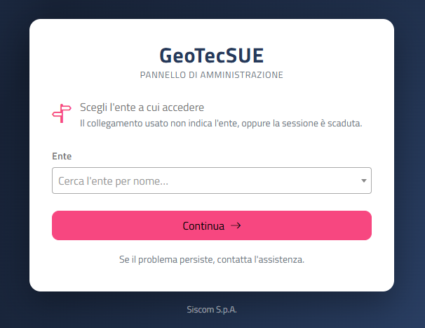
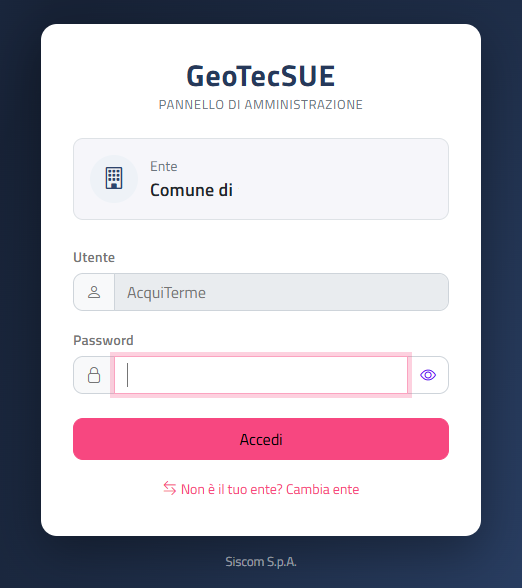

# Accesso al back office

Questa sezione spiega come entrare nel back office di **GeoTecSUE** (il "Pannello di amministrazione" dell'Ente), come scegliere l'Ente giusto, cosa significano i messaggi di errore e come uscire.

## Accedere alla pagina

Puoi arrivare alla pagina di accesso in tre modi:

| Come arrivi | Cosa succede |
|-------------|--------------|
| Con il **collegamento personale dell'Ente** (l'indirizzo del back office che contiene il codice del tuo Ente) | Si apre direttamente la pagina di accesso con il nome del tuo Ente già indicato. |
| Con l'**indirizzo del back office senza altre indicazioni** (solo l'indirizzo del sito) | Si apre la pagina **Scegli l'ente a cui accedere**, dove selezioni il tuo Ente. |
| Dal **portale GeoTecSUE**, con il collegamento al back office (click su *Pannello di Amministrazione* in basso a destra). | Si apre direttamente la pagina di accesso con il nome del tuo Ente già indicato. |

{: .note }
> Conserva tra i preferiti del browser il collegamento personale del tuo Ente: così trovi già l'Ente selezionato e devi inserire solo la password.

## Scegliere l'Ente

La pagina **Scegli l'ente a cui accedere** compare quando il collegamento usato non indica l'Ente oppure quando la sessione è scaduta. Il messaggio sotto il titolo lo ricorda: *"Il collegamento usato non indica l'ente, oppure la sessione è scaduta."*

Per scegliere l'Ente:

1. Clicca sul campo **Ente**.
2. Scrivi una parte del nome dell'Ente nella casella di ricerca (*"Cerca l'ente per nome…"*). L'elenco è in ordine alfabetico.
3. Seleziona il tuo Ente.
4. Clicca su **Continua** (oppure premi Invio).

Si apre la pagina di accesso del tuo Ente.

### Messaggi della pagina di scelta

| Messaggio | Cosa significa | Cosa fare |
|-----------|----------------|-----------|
| *Seleziona l'ente dall'elenco.* | Hai cliccato **Continua** senza scegliere un Ente. | Seleziona un Ente e clicca di nuovo **Continua**. |
| *Non è stato possibile caricare l'elenco degli enti. Riprova tra qualche minuto.* | Il servizio non è raggiungibile in questo momento. | Clicca su **Riprova** dopo qualche minuto. |
| *Nessun ente disponibile.* | L'elenco degli enti è vuoto. | Clicca su **Riprova**; se il problema resta, contatta l'assistenza. |

In fondo alla pagina trovi l'indicazione *"Se il problema persiste, contatta l'assistenza."*

## La pagina di accesso

La pagina di accesso mostra, dall'alto verso il basso:

- il marchio **GeoTecSUE** con la scritta *Pannello di amministrazione*;
- il riquadro **Ente** con il nome del tuo Ente;
- il campo **Utente**, già compilato con il nome utente dell'Ente e non modificabile;
- il campo **Password**;
- il pulsante **Accedi**;
- il collegamento **Non è il tuo ente? Cambia ente**.

### Entrare nel back office

1. Controlla che nel riquadro **Ente** sia indicato il tuo Ente.
2. Scrivi la password nel campo **Password**.
3. Clicca su **Accedi** (oppure premi Invio).

Durante la verifica compare lo spinner di caricamento. Se la password è corretta si apre la [Scheda Ente](scheda-ente.html), che è la pagina iniziale del back office.

{: .note }
> Per controllare cosa hai scritto, clicca sul pulsante con l'**occhio** a destra del campo **Password**: la password diventa visibile. Clicca di nuovo (occhio barrato) per nasconderla.

### Cambiare Ente

Se il nome nel riquadro **Ente** non è quello giusto:

1. Clicca su **Non è il tuo ente? Cambia ente**.
2. Nella pagina **Scegli l'ente a cui accedere** seleziona l'Ente corretto e clicca su **Continua**.

### Ente non trovato

Se il collegamento contiene il codice di un Ente che non esiste o non è più attivo, al posto dei campi di accesso compare l'avviso:

*"L'ente indicato nel collegamento non esiste o non è più attivo."*

Clicca su **Scegli l'ente** per aprire la pagina di scelta e selezionare l'Ente dall'elenco. Se il collegamento è salvato tra i preferiti, aggiornalo con quello corretto.

### Messaggi di errore all'accesso

Gli errori compaiono in un riquadro rosso sopra i campi.

| Messaggio | Cosa significa | Cosa fare |
|-----------|----------------|-----------|
| *Inserisci la password.* | Hai cliccato **Accedi** con il campo **Password** vuoto. | Scrivi la password e riprova. |
| *Accesso non riuscito: verifica la password e riprova.* | La password non è corretta. | Controlla maiuscole/minuscole (usa l'occhio per vederla) e riprova. |
| *Il servizio di accesso non è al momento disponibile. Riprova tra qualche minuto.* | Il servizio di autenticazione non risponde. | Attendi qualche minuto e riprova; se persiste, contatta l'assistenza. |

{: .note }
> Dopo una password errata la risposta arriva con un breve ritardo: è normale. Attendi il messaggio prima di riprovare.

## Uscire dal back office

Per uscire clicca su **Log Out**, il pulsante a forma di pillola in alto a destra nel menu.

Il back office chiude la sessione di lavoro e riapre la pagina di accesso **dello stesso Ente**: se vuoi rientrare devi inserire di nuovo la password.

{: .note }
> Esci sempre con **Log Out** quando hai finito, soprattutto se il computer è condiviso con altri colleghi.

## Sessione scaduta

Dopo un periodo di inattività la sessione di lavoro scade.

Mentre una pagina del back office è aperta, il browser invia al server una richiesta automatica ogni 5 minuti per mantenere attiva la sessione. In questo modo, in genere, puoi lasciare una pagina aperta mentre consulti documenti senza dover rientrare.

Se la sessione è comunque scaduta, alla prima operazione (clic su un pulsante, apertura di una pagina dal menu, scaricamento di un PDF):

1. vieni riportato alla pagina **Scegli l'ente a cui accedere**;
2. seleziona il tuo Ente e clicca su **Continua**;
3. inserisci la password e clicca su **Accedi**.

Si riapre la [Scheda Ente](scheda-ente.html): torna alla pagina su cui stavi lavorando dal menu.

{: .warning }
> Le modifiche non salvate al momento della scadenza della sessione vanno perse. Se hai lasciato una pagina aperta a lungo, prima di inserire molti dati ricarica la pagina o salva spesso.

## Problemi frequenti

| Problema | Soluzione |
|----------|-----------|
| Il campo **Utente** non si può modificare | È normale: il nome utente è quello dell'Ente indicato nel riquadro **Ente**. Se l'Ente è sbagliato usa **Cambia ente**. |
| Si apre sempre la scelta dell'Ente | Il collegamento che usi non contiene il codice dell'Ente, oppure la sessione è scaduta. Dopo aver scelto l'Ente salva tra i preferiti l'indirizzo della pagina di accesso. |
| Password dimenticata | Contatta l'assistenza. |

Per conoscere il resto dell'interfaccia continua con [Interfaccia e convenzioni](interfaccia-e-convenzioni.html).
