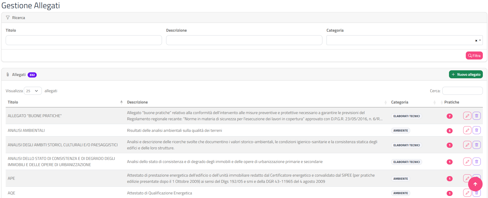
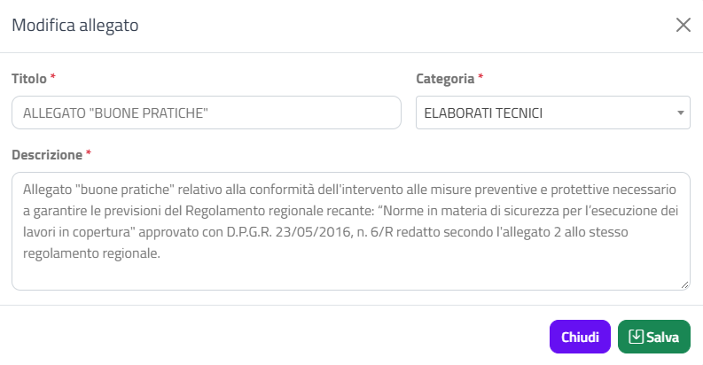

# Allegati

Questa sezione spiega come gestire il **catalogo dei tipi di allegato** del tuo Ente: l'elenco dei documenti (relazioni, elaborati, dichiarazioni…) che puoi poi richiedere ai professionisti nelle diverse pratiche.

## Accedere alla pagina

Dal menu in alto scegli **Impostazioni › Allegati**. Si apre la pagina **Gestione Allegati**.

## Allegati e Allegati in pratica: la differenza

Il back office gestisce gli allegati in due passaggi distinti:

| Pagina | Cosa definisci | Esempio |
|--------|----------------|---------|
| **Allegati** (questa pagina) | Il *catalogo*: quali tipi di allegato esistono, con titolo, descrizione e categoria | "Relazione tecnica asseverata", categoria "Elaborati" |
| [Allegati in pratica](allegati-in-pratica.html) | Per ogni tipo di pratica: quali allegati del catalogo sono richiesti, se sono obbligatori, se devono essere firmati digitalmente e quale tipo di file è accettato | Nella SCIA la relazione è obbligatoria, in PDF e firmata |

In pratica: prima crei (o verifichi) l'allegato qui, poi lo attivi nelle pratiche in cui deve comparire dalla pagina [Allegati in pratica](allegati-in-pratica.html). Un allegato creato qui e non attivato in nessuna pratica non viene richiesto al professionista.

{: .note }
> Puoi stampare l'elenco degli allegati in PDF dalla [Scheda Ente](scheda-ente.html), riquadro **Stampa allegati**.

## Cercare un allegato

Il riquadro **Ricerca**, in alto, filtra l'elenco con tre campi:

| Campo | Come funziona |
|-------|---------------|
| **Titolo** | Mostra gli allegati il cui titolo contiene il testo scritto (maiuscole e minuscole sono indifferenti) |
| **Descrizione** | Come sopra, sulla descrizione |
| **Categoria** | Menu a tendina con ricerca; lascia "-- Tutte le categorie --" per non filtrare |

1. Compila uno o più campi.
2. Clicca su **Filtra** (oppure premi Invio in un campo di testo).

Con un filtro attivo il contatore accanto al titolo **Allegati** mostra ad esempio "12 su 140" e compare il pulsante **Rimuovi filtri**, che svuota i campi e mostra di nuovo tutti gli allegati.

Oltre a questi filtri, la tabella ha la casella **Cerca** e l'ordinamento per colonna descritti in [Interfaccia e convenzioni](interfaccia-e-convenzioni.html).

## L'elenco degli allegati

La tabella mostra 25 allegati per pagina, ordinati per titolo.

| Colonna | Contenuto |
|---------|-----------|
| **Titolo** | Il nome dell'allegato, come lo vede il professionista |
| **Descrizione** | Il testo descrittivo; se è lungo ne vedi due righe, il testo completo compare passando il mouse sopra |
| **Categoria** | La categoria, in un'etichetta grigia |
| **Pratiche** | In quanti tipi di pratica l'allegato è attivo: un badge rosso con il numero se è usato, "0" grigio se non è usato in nessuna pratica |
| (pulsanti) | Matita per modificare, cestino per eliminare |

## Creare un nuovo allegato

1. Clicca su **Nuovo allegato**, in alto a destra nel riquadro **Allegati**.
2. Nella finestra **Nuovo allegato** compila i campi (tutti obbligatori, segnati da un asterisco rosso):

   | Campo | Contenuto |
   |-------|-----------|
   | **Titolo** | Nome breve dell'allegato |
   | **Categoria** | Scegli una categoria dall'elenco |
   | **Descrizione** | Spiegazione di cosa deve contenere il documento |

3. Clicca su **Salva**.

Se manca un dato compare la finestra **Attenzione** con il messaggio "Inserire il titolo.", "Inserire la descrizione." oppure "Selezionare una categoria."; chiudendola torni alla finestra di modifica con quanto avevi già scritto. A salvataggio riuscito compare la notifica verde **Allegato creato** e l'elenco si aggiorna.

{: .note }
> Il nuovo allegato non è ancora richiesto in nessuna pratica (colonna **Pratiche** a 0). Per farlo comparire al professionista attivalo nelle pratiche desiderate da [Allegati in pratica](allegati-in-pratica.html).

## Modificare un allegato

1. Clicca sulla **matita** nella riga dell'allegato.
2. Nella finestra **Modifica allegato** cambia **Titolo**, **Categoria** o **Descrizione**.
3. Clicca su **Salva**: compare la notifica **Allegato salvato**.

{: .warning }
> Titolo, descrizione e categoria sono comuni a tutte le pratiche in cui l'allegato è attivo: la modifica vale per tutte, e quindi per quello che vedono i professionisti.

## Eliminare un allegato

Puoi eliminare solo un allegato che non è attivo in nessuna pratica (colonna **Pratiche** a 0). Se l'allegato è usato, il cestino è grigio e disattivato; passando il mouse sopra leggi in quanti tipi di pratica è usato.

1. Clicca sul **cestino** rosso nella riga dell'allegato.
2. Nella finestra **Eliminare l'allegato?** controlla il titolo mostrato.
3. Clicca su **Elimina**.

{: .warning }
> L'operazione non si può annullare.

Per eliminare un allegato ancora usato, disattivalo prima in tutte le pratiche da [Allegati in pratica](allegati-in-pratica.html). Se nel frattempo qualcuno lo ha attivato in una pratica, l'eliminazione viene rifiutata con il messaggio "L'allegato è associato a delle pratiche e non può essere eliminato."

## Pagine collegate

- [Allegati in pratica](allegati-in-pratica.html): attivare gli allegati nei tipi di pratica e impostare obbligatorietà, firma e formato.
- [Modulistica](modulistica.html): collegare agli allegati i modelli scaricabili.
- [Scheda Ente](scheda-ente.html): stampa in PDF della lista allegati.
