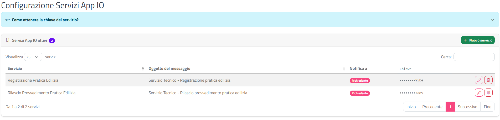
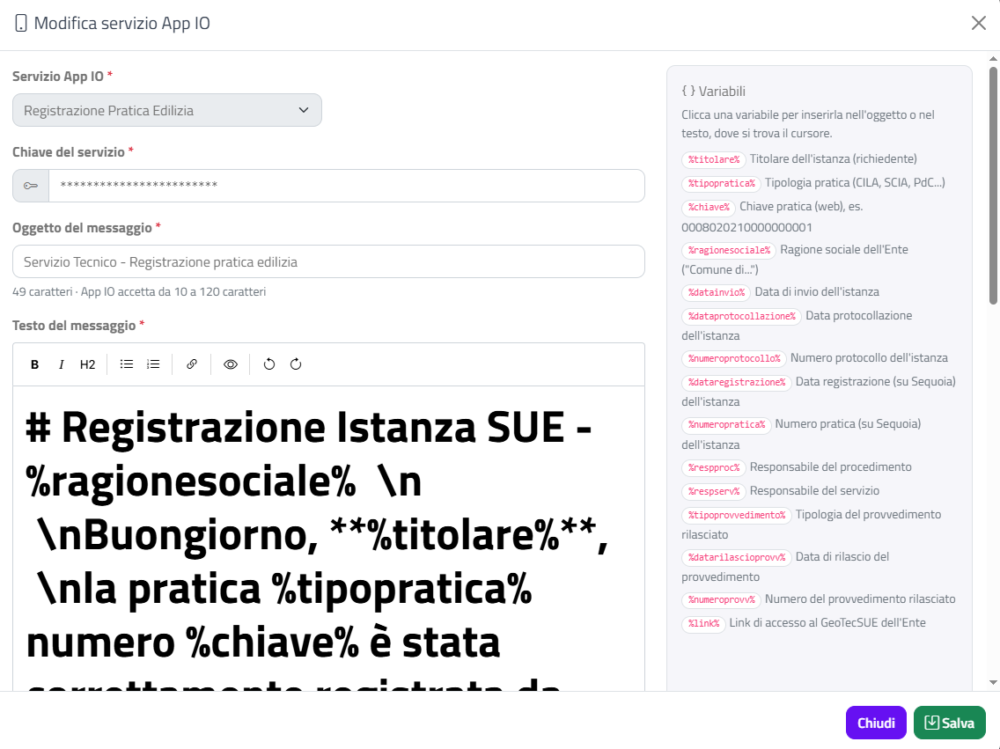

# Servizi App IO

Questa sezione spiega come configurare i **servizi App IO** del tuo Ente, cioè i messaggi che GeoTecSUE può inviare tramite l'app IO al richiedente e/o al professionista di una pratica.

## Accedere alla pagina

Dal menu in alto scegli **Impostazioni › Servizi App IO**. Si apre la pagina **Configurazione Servizi App IO**.

## Come ottenere la chiave del servizio

Per ogni servizio serve una **chiave** rilasciata da App IO. In alto nella pagina, clicca sul riquadro azzurro **Come ottenere la chiave del servizio?** per leggere i passaggi:

1. Accedi al **back office di IO** con le credenziali del delegato indicato nella convenzione stipulata con App IO (il riquadro contiene il link a io.italia.it/pubbliche-amministrazioni).
2. Registra il servizio *Sportello Unico Edilizia – Comunicazione*, come indicato nelle note operative ricevute via mail.
3. Dopo la verifica del team *PagoPA* recupera la **chiave primaria** del servizio: è quella da usare per tutti i servizi da attivare su **GeoTecSUE**.

## L'elenco dei servizi

Il riquadro **Servizi App IO attivi** mostra i servizi configurati; il numero accanto al titolo ne indica il totale. Se non ce n'è nessuno leggi "Nessun servizio App IO configurato: usa **Nuovo servizio** per aggiungerne uno."

| Colonna | Contenuto |
|---------|-----------|
| **Servizio** | Il tipo di servizio App IO |
| **Comune** | Il comune a cui si riferisce (solo per gli Enti con più comuni) |
| **Oggetto del messaggio** | L'oggetto del messaggio inviato (due righe; il testo completo passando il mouse sopra) |
| **Notifica a** | Etichette **Richiedente** e/o **Professionista** |
| **Chiave** | La chiave del servizio, nascosta tranne le ultime 4 cifre |
| (pulsanti) | Matita per modificare, cestino per eliminare |

## Aggiungere un servizio

1. Clicca su **Nuovo servizio**, in alto a destra nel riquadro.
2. Nella finestra **Nuovo servizio App IO** scegli il **Servizio App IO** dal menu. Il sistema propone subito un oggetto e un testo predefiniti per quel servizio.
3. Solo per gli Enti con più comuni: scegli il **Comune**.
4. Incolla la **Chiave del servizio**.
5. Controlla l'**Oggetto del messaggio** e il **Testo del messaggio** proposti: si consiglia di **lasciarli come sono** (vedi [Scrivere oggetto e testo](#scrivere-oggetto-e-testo)).
6. In **Invia la notifica a** accendi **Richiedente**, **Professionista** o entrambi (per default è acceso solo **Richiedente**).
7. Clicca su **Salva**: compare la notifica **Servizio aggiunto**.

{: .warning }
> Se cambi il servizio scelto nel menu, oggetto e testo vengono sostituiti con quelli predefiniti del nuovo servizio: quello che avevi scritto va perso.

Tutti i campi sono obbligatori. Se manca qualcosa compare la finestra **Attenzione** (ad esempio "Inserire la chiave del servizio." oppure "Scegliere a chi inviare la notifica: richiedente e/o professionista."); chiudendola torni alla finestra del servizio con i dati inseriti.

## Scrivere oggetto e testo

{: .warning }
> **Si consiglia vivamente di NON modificare l'oggetto e il testo dei messaggi proposti dal sistema.**
>
> I testi predefiniti hanno il formato richiesto da App IO: le variabili tra `%` (ad esempio `%titolare%`), i simboli di formattazione e le sequenze `\n` che indicano l'andata a capo. Anche una piccola modifica può causare **errori di formato in fase di trasmissione** a App IO.
>
> Se una modifica è proprio necessaria, cambia solo le parole e lascia invariati variabili, simboli e sequenze `\n`; in caso di dubbi contatta l'assistenza.

### Contatori di caratteri

Sotto **Oggetto del messaggio** e **Testo del messaggio** un contatore indica i caratteri scritti e i limiti accettati da App IO:

| Campo | Limiti indicati |
|-------|-----------------|
| Oggetto | da 10 a 120 caratteri |
| Testo | da 80 a 10.000 caratteri |

Se sei fuori dai limiti il contatore diventa rosso con un'icona di avviso. Il contatore è solo un'indicazione e non blocca il salvataggio: la lunghezza finale dipende anche dal valore delle variabili.

### Editor del testo

Il **Testo del messaggio** si scrive in formato Markdown, con una barra di strumenti: **Grassetto**, **Corsivo**, **Titolo**, **Elenco puntato**, **Elenco numerato**, **Link**, **Anteprima** (per vedere il testo formattato), **Annulla** e **Ripeti**.

### Variabili

Nel riquadro **Variabili**, a destra, trovi i segnaposto che al momento dell'invio vengono sostituiti con i dati della pratica. Clicca su una variabile per inserirla nell'oggetto o nel testo, nel punto in cui si trova il cursore (l'ultimo campo in cui hai cliccato).

| Variabile | Significato |
|-----------|-------------|
| `%titolare%` | Titolare dell'istanza (richiedente) |
| `%tipopratica%` | Tipologia pratica (CILA, SCIA, PdC...) |
| `%chiave%` | Chiave pratica (web), es. 0008020210000000001 |
| `%ragionesociale%` | Ragione sociale dell'Ente ("Comune di...") |
| `%datainvio%` | Data di invio dell'istanza |
| `%dataprotocollazione%` | Data protocollazione dell'istanza |
| `%numeroprotocollo%` | Numero protocollo dell'istanza |
| `%dataregistrazione%` | Data registrazione (su Sequoia) dell'istanza |
| `%numeropratica%` | Numero pratica (su Sequoia) dell'istanza |
| `%respproc%` | Responsabile del procedimento |
| `%respserv%` | Responsabile del servizio |
| `%tipoprovvedimento%` | Tipologia del provvedimento rilasciato |
| `%datarilascioprovv%` | Data di rilascio del provvedimento |
| `%numeroprovv%` | Numero del provvedimento rilasciato |
| `%link%` | Link di accesso al GeoTecSUE dell'Ente |

## Modificare un servizio

1. Clicca sulla **matita** nella riga del servizio.
2. Nella finestra **Modifica servizio App IO** puoi cambiare chiave, oggetto, testo e destinatari (per oggetto e testo vedi l'avviso in [Scrivere oggetto e testo](#scrivere-oggetto-e-testo)). Il servizio e il comune non si possono cambiare (i menu sono bloccati): per cambiarli elimina il servizio e creane uno nuovo.
3. Clicca su **Salva**: compare la notifica **Servizio salvato**.

## Eliminare un servizio

1. Clicca sul **cestino** nella riga del servizio.
2. Nella finestra **Eliminare il servizio?** controlla il nome mostrato.
3. Clicca su **Elimina**: compare la notifica **Servizio eliminato**.

{: .warning }
> Dopo l'eliminazione non verranno più inviate notifiche su App IO per questo servizio. L'operazione non si può annullare.

## Pagine collegate

- [Comunicazioni](comunicazioni.html), [Mail](mail.html) e [Configurazioni PEC](configurazioni-pec.html): gli altri canali con cui l'Ente comunica con professionisti e richiedenti.
- [Interfaccia e convenzioni](interfaccia-e-convenzioni.html): notifiche e finestra Attenzione.
