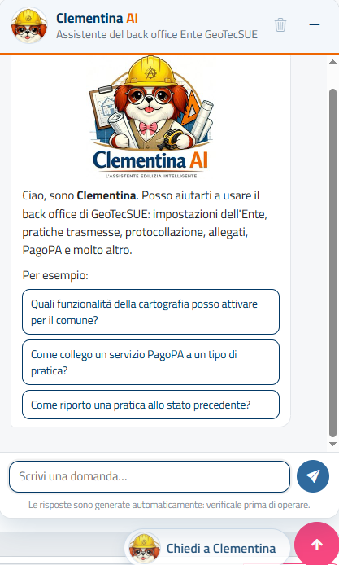
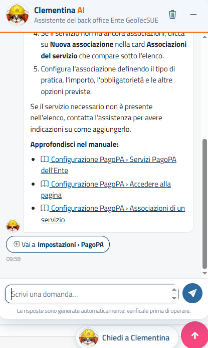

# Assistente Clementina

Questa sezione spiega come usare **Clementina**, l'assistente basato sull'intelligenza artificiale che trovi in tutte le pagine del back office: a cosa serve, come farle una domanda, come leggere le risposte e quali sono i suoi limiti.

## Cosa sa fare

Clementina risponde alle domande su **come si usa il back office**: dove si trova una funzione, quali passaggi seguire per un'operazione, cosa significa un'impostazione o uno stato della pratica.

- Le risposte si basano su **questo manuale** e, per le domande sulla normativa edilizia, sul **Testo unico dell'edilizia** (D.P.R. 380/2001).
- Conosce alcune **impostazioni del tuo Ente**, ad esempio i tipi di pratica attivi e le funzioni attive o no (PagoPA, protocollazione, invio libero di documentazione, consultazione web, pratiche importate…), così le risposte riguardano il tuo back office e non uno generico.
- Tiene conto della **pagina in cui ti trovi** quando fai la domanda: puoi chiedere "come faccio qui a…" mentre stai lavorando.
- Ricorda i messaggi precedenti della conversazione, quindi puoi fare domande di seguito ("e se invece…", "dove trovo quel pulsante?").

{: .warning }
> Clementina **non esegue operazioni** e non modifica alcun dato: ti dice come fare, ma le operazioni le fai tu. Non legge il contenuto delle singole pratiche né i dati dei professionisti. Le risposte sono generate automaticamente e possono contenere errori: **verificale prima di operare**, aiutandoti con i collegamenti al manuale. Per anomalie o problemi tecnici rivolgiti all'assistenza.

## Aprire e chiudere la chat

Il pulsante **Chiedi a Clementina**, con la sua immagine, si trova in basso a destra in ogni pagina. Su schermi piccoli compare solo l'immagine e la chat si apre a tutto schermo.

| Comando | Effetto |
|---------|---------|
| Pulsante **Chiedi a Clementina** | Apre il pannello della chat; cliccandolo di nuovo lo chiude. |
| **Trattino** (Riduci a icona) in alto nel pannello | Chiude il pannello: la conversazione resta e la ritrovi alla riapertura. |
| Tasto **Esc** | Riduce a icona il pannello. Se è aperto il pannello della [Guida in linea](interfaccia-e-convenzioni.html#guida-in-linea), Esc chiude prima quello. |
| **Cestino** (Cancella la conversazione) in alto nel pannello | Chiede *Cancellare tutta la conversazione?*: con **Cancella** la conversazione si azzera e ne inizia una nuova, con **Annulla** resta com'è. |

{: .note }
> Se il pulsante **Chiedi a Clementina** non compare, l'assistente non è attivo per il tuo back office: rivolgiti all'assistenza.

## Fare una domanda

1. Scrivi la domanda nella casella **Scrivi una domanda…** in fondo al pannello.
2. Premi **Invio** oppure clicca sul pulsante con l'**aeroplanino**. Per andare a capo senza inviare usa **Maiusc+Invio**.
3. Mentre Clementina sta scrivendo compaiono tre puntini animati e la casella resta bloccata: attendi la risposta.

La domanda può essere lunga al massimo 2.000 caratteri.

### Domande suggerite

Quando la conversazione è vuota, il messaggio di benvenuto propone alcune **domande di esempio**, scelte in base alle funzioni attive per il tuo Ente: ad esempio una domanda su PagoPA compare solo se il tuo Ente usa PagoPA. Cliccane una per inviarla subito. A ogni nuova conversazione le domande proposte possono cambiare.

### Come ottenere risposte migliori

- Fai **una domanda alla volta** e descrivi cosa vuoi ottenere ("come rendo obbligatorio un allegato nella SCIA?") più che il problema in generale.
- Usa i nomi che vedi nel back office: voci di menu, titoli delle card, nomi dei pulsanti.
- Per i tipi di pratica puoi usare la sigla (CILA, SCIA, PdC…) o il nome per esteso; Clementina riconosce anche i nomi alternativi più comuni (vedi [Tipologie di pratica](appendici/tipologie-pratica.html)).
- Se cambi argomento, inizia una nuova conversazione con il **cestino**: le domande precedenti su un altro tema possono confondere la risposta.

## Le risposte

Le risposte sono scritte come istruzioni operative, spesso con passaggi numerati. Sotto il testo possono comparire due tipi di collegamenti.

| Collegamento | A cosa serve |
|--------------|--------------|
| **Approfondisci nel manuale** | Elenco delle sezioni del manuale da cui proviene la risposta. Cliccando un collegamento si apre il pannello della [Guida in linea](interfaccia-e-convenzioni.html#guida-in-linea) con la sola sezione indicata, senza lasciare la pagina. |
| **Vai a …** | Pulsante che apre la pagina del back office in cui si esegue l'operazione (ne compaiono al massimo due). La chat resta aperta nella nuova pagina. Se ti trovi già in quella pagina il pulsante diventa **Sei già in …**; per le pagine di dettaglio è indicato tra parentesi di aprire la pratica dall'elenco. |

Se chiedi di una funzione che **non è attiva per il tuo Ente** (ad esempio una voce di menu che non vedi), Clementina te lo dice e non ti propone pagine o sezioni che nel tuo back office non ci sono.

## La conversazione

- La conversazione **resta** mentre passi da una pagina all'altra del back office nella stessa scheda del browser; anche il pannello resta aperto o chiuso come l'hai lasciato.
- Si **azzera** quando la cancelli con il cestino oppure quando chiudi la scheda del browser. Ogni scheda del browser ha la sua conversazione.
- Se cambi pagina mentre Clementina sta rispondendo, la risposta va persa: nella nuova pagina compare un messaggio che ti invita a ripetere la domanda.

## Limiti e messaggi

Ogni operatore può fare un **numero massimo di domande al giorno**. Raggiunto il limite, Clementina risponde che potrai riprovare il giorno dopo.

| Messaggio | Cosa fare |
|-----------|-----------|
| *È stato raggiunto il numero massimo di domande per oggi. Potrai riprovare domani.* | Hai esaurito le domande della giornata. Nel frattempo puoi consultare il manuale o la [Guida in linea](interfaccia-e-convenzioni.html#guida-in-linea). |
| *La sessione è scaduta: ricarica la pagina e accedi di nuovo al back office.* | Ricarica la pagina ed esegui di nuovo l'accesso. |
| *Clementina non è raggiungibile in questo momento. Riprova tra poco.* / *Si è verificato un problema tecnico. Riprova tra qualche istante.* | Il servizio è momentaneamente non disponibile: riprova dopo qualche minuto. Se il problema continua, rivolgiti all'assistenza. |
| *Connessione non riuscita. Controlla la rete e riprova.* | Controlla la connessione a Internet e invia di nuovo la domanda. |
| *La risposta alla domanda precedente non è arrivata perché nel frattempo hai cambiato pagina. Puoi ripeterla.* | Riscrivi la domanda (o ricopiala) e attendi la risposta senza cambiare pagina. |

## Registrazione delle conversazioni

{: .note }
> Le domande e le risposte vengono **registrate**, insieme all'Ente e all'operatore che le ha fatte, per l'assistenza e per migliorare il servizio. Non inserire nelle domande dati personali non necessari (nominativi, codici fiscali, recapiti…): per chiedere come si fa un'operazione non servono.

## Pagine collegate

- [Interfaccia e convenzioni](interfaccia-e-convenzioni.html): gli elementi comuni a tutte le pagine, compresa la [Guida in linea](interfaccia-e-convenzioni.html#guida-in-linea).
- [Tipologie di pratica](appendici/tipologie-pratica.html): sigle e nomi alternativi dei tipi di pratica.
- [Glossario](appendici/glossario.html): definizioni dei termini usati nel manuale.
