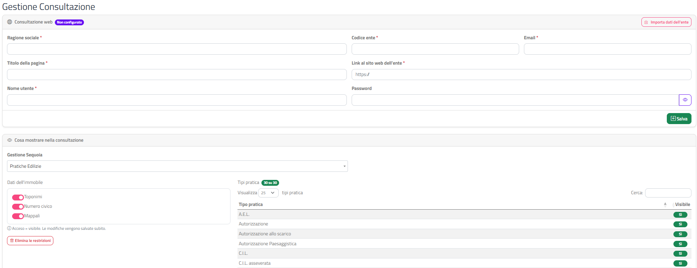
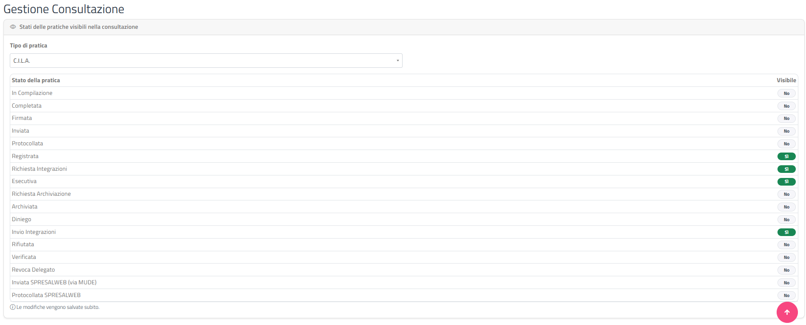

# Consultazione

Questa sezione spiega come configurare la consultazione delle pratiche dell'Ente: quali consultazioni esistono, come attivarle, come ottenere il link pubblico e come stabilire quali informazioni vi compaiono.

La pagina si presenta in due modi diversi, a seconda della configurazione dell'Ente:

| Modalità | Quando compare | Quali pratiche mostra |
|----------|----------------|-----------------------|
| **Nuova gestione** | Nella [Scheda Ente](scheda-ente.html) è attivo **Attiva consultazione Online** | **Tutte** le pratiche presenti nel gestionale Sequoia, lette direttamente da Sequoia. |
| **Vecchia gestione** (in dismissione) | **Attiva consultazione Online** non è attivo | **Solo** le pratiche presentate tramite GeoTecSUE. |

{: .warning }
> La **vecchia gestione è in fase di dismissione**, perché non copre tutte le pratiche del gestionale Sequoia ma solo quelle presentate tramite il portale GeoTecSUE. Se il tuo Ente la usa ancora, passa alla nuova gestione attivando **Attiva consultazione Online** nella [Scheda Ente](scheda-ente.html#interruttori).

{: .note }
> Nella Scheda Ente l'opzione **Attiva consultazione Online** è selezionabile solo se per l'Ente è configurata almeno una gestione Sequoia (il gestionale delle pratiche collegato a GeoTecSUE). Se non la vedi attivabile, rivolgiti all'assistenza.

## Le due consultazioni della nuova gestione

Con la nuova gestione le pratiche dell'Ente, prese da Sequoia, si possono consultare in **due modi diversi**, che l'Ente può usare insieme:

| | **Consultazione in GeoTecSUE** | **Consultazione web** |
|---|---|---|
| **Cos'è** | Una pagina di consultazione **all'interno del portale GeoTecSUE**. | Una **pagina web a sé stante**, separata dal portale, con un proprio indirizzo (link). |
| **Chi la usa** | I professionisti registrati al portale e gli [utenti in consultazione](utenti.html) creati dall'Ente, con le proprie credenziali. | **Chiunque** abbia il link: cittadini, professionisti, altri uffici. Non serve essere registrati a GeoTecSUE. |
| **Dove si trova** | Dentro GeoTecSUE, dopo l'accesso. | Ovunque l'Ente pubblichi il link: ad esempio sul **sito istituzionale**, in una mail o in una comunicazione. |
| **Come si attiva** | Con **Attiva consultazione Online** nella [Scheda Ente](scheda-ente.html#interruttori). | Compilando e salvando la scheda [Consultazione web](#consultazione-web) di questa pagina, che genera il link. |

In entrambe valgono le stesse regole su cosa mostrare, impostate nella scheda [Cosa mostrare nella consultazione](#cosa-mostrare-nella-consultazione): se nascondi un dato o un tipo di pratica, non compare né nella consultazione in GeoTecSUE né nella Consultazione web.

{: .note }
> La **Consultazione web** è utile come primo passo per chi cerca informazioni su una pratica edilizia, prima di un'eventuale richiesta di accesso agli atti: chiunque può verificare in autonomia l'esistenza e i dati principali di una pratica, senza contattare l'ufficio.

## Accedere alla pagina

Dal menu in alto scegli **Impostazioni › Consultazione**. La pagina si intitola **Gestione Consultazione**.

## Nuova gestione

La nuova gestione è composta da due schede: **Consultazione web** e **Cosa mostrare nella consultazione**.

### Consultazione web

Questa scheda serve a creare la **Consultazione web**, la pagina pubblica a sé stante descritta [sopra](#le-due-consultazioni-della-nuova-gestione): contiene i dati dell'Ente usati da quella pagina e, una volta attivata, il link da pubblicare. Accanto al titolo un badge indica lo stato:

| Badge | Significato |
|-------|-------------|
| **Attivo** (verde) | La consultazione web è attiva e il link funziona. |
| **Non configurato** (viola) | La consultazione web non è ancora stata attivata. |

#### Link alla consultazione

Quando la consultazione è attiva, in cima alla scheda compare il campo **Link alla consultazione** (sola lettura), con due pulsanti:

- **Copia** (icona appunti): copia il link negli appunti; l'icona diventa verde per un istante a conferma.
- **Apri** (icona freccia): apre il link in una nuova scheda del browser.

Il link termina con il **Codice ente** e funziona ovunque venga usato: puoi pubblicarlo sul sito istituzionale dell'Ente, inserirlo in una pagina informativa o inviarlo per mail. Chiunque lo apra può consultare le pratiche, senza registrarsi a GeoTecSUE, nei limiti impostati in [Cosa mostrare nella consultazione](#cosa-mostrare-nella-consultazione).

#### Campi

Tutti i campi sono obbligatori, tranne la password quando la consultazione è già attiva.

| Campo | Descrizione |
|-------|-------------|
| **Ragione sociale** | Nome dell'Ente mostrato nella consultazione. |
| **Codice ente** | Codice identificativo dell'Ente; compone la parte finale del link. |
| **Email** | Indirizzo email dell'Ente associato alla consultazione. |
| **Titolo della pagina** | Titolo mostrato nella pagina di consultazione. |
| **Link al sito web dell'ente** | Indirizzo del sito istituzionale (inizia con `https://`). |
| **Nome utente** | Credenziale dell'Ente per la consultazione web. |
| **Password** | Password associata al nome utente. Non viene mai mostrata: se la consultazione è già attiva, lascia il campo vuoto per mantenere quella salvata. Il pulsante con l'occhio mostra o nasconde quello che digiti. |

#### Importare i dati dell'Ente

Il pulsante **Importa dati dell'ente**, in alto a destra nella scheda, compila automaticamente **Ragione sociale**, **Codice ente**, **Nome utente** ed **Email** con i dati dell'Ente, e prepara anche la password dell'Ente senza mostrarla.

1. Clicca su **Importa dati dell'ente**.
2. Compare la notifica **Dati importati dall'ente** con l'invito a completare il resto.
3. Sotto il campo **Password** compare la nota *"Password importata dai dati dell'ente: lascia il campo vuoto per usarla."*
4. Compila **Titolo della pagina** e **Link al sito web dell'ente**.
5. Clicca su **Salva**.

{: .note }
> I dati importati non sono salvati finché non clicchi su **Salva**. Se esci dalla pagina prima, l'importazione va ripetuta.

#### Attivare o aggiornare la consultazione web

1. Compila i campi (oppure usa **Importa dati dell'ente**).
2. Clicca su **Salva**.
3. Se manca qualche dato compare la finestra **Attenzione** con l'elenco dei campi da compilare (es. *"Compilare: titolo della pagina, link al sito web."*).
4. Al primo salvataggio compare la notifica **Consultazione web attivata**; nei successivi **Dati salvati**. Il badge diventa **Attivo** e compare il link.

#### Disattivare la consultazione web

1. Clicca su **Disattiva consultazione web** (visibile solo quando la consultazione è attiva).
2. Si apre la finestra **Disattivare la consultazione web?** con l'avviso *"I dati dell'ente per la consultazione web verranno eliminati e il link non funzionerà più."*
3. Clicca su **Disattiva** per confermare, oppure su **Annulla**.

{: .warning }
> Dopo la disattivazione il link pubblicato smette di funzionare per chiunque lo usi. Per riattivare la consultazione dovrai reinserire i dati, compresa la password.

### Cosa mostrare nella consultazione

In questa scheda definisci le **restrizioni** della consultazione, cioè cosa viene nascosto, separatamente per ogni gestione Sequoia dell'Ente. Le restrizioni valgono **per entrambe** le consultazioni: quella all'interno di GeoTecSUE e la Consultazione web pubblica.

1. Nel campo **Gestione Sequoia** scegli la gestione da configurare.
   - Se l'Ente non ha gestioni, compare il messaggio *"Nessuna gestione Sequoia configurata per l'ente."*
2. Se per quella gestione non ci sono ancora restrizioni, compare il messaggio *"Per questa gestione non sono ancora state impostate restrizioni."* con il pulsante **Imposta restrizioni**.
3. Clicca su **Imposta restrizioni**: compare la notifica **Restrizioni create** (*"Ora tutto è visibile: spegni ciò che non vuoi mostrare."*) e appaiono gli interruttori e la tabella.

{: .note }
> Tutte le modifiche di questa scheda (interruttori e badge) vengono **salvate subito**, senza un pulsante Salva. Ogni modifica è confermata da una notifica verde.

#### Dati dell'immobile

Tre interruttori stabiliscono quali dati di localizzazione dell'immobile sono visibili. Interruttore **acceso = visibile**.

| Interruttore | Cosa controlla |
|--------------|----------------|
| **Toponimi** | La via/piazza dell'immobile. |
| **Numero civico** | Il numero civico. |
| **Mappali** | I riferimenti catastali (mappali). |

Ad ogni cambio compare la notifica **Dato visibile nella consultazione** oppure **Dato nascosto nella consultazione**, con il nome del dato.

#### Tipi pratica

La tabella elenca i tipi di pratica letti dal gestionale Sequoia per la gestione scelta. Accanto al titolo **Tipi pratica** un badge verde riporta quanti sono visibili (es. "12 su 15").

| Colonna | Contenuto |
|---------|-----------|
| **Tipo pratica** | Descrizione del tipo di pratica (se manca, compare *"(senza descrizione)"*). |
| **Visibile** | Badge **Sì** (verde) se le pratiche di quel tipo sono visibili, **No** (grigio) se sono nascoste. |

Per mostrare o nascondere un tipo di pratica clicca sul suo badge **Sì**/**No**: il valore si inverte e compare la notifica **Tipo pratica visibile nella consultazione** o **Tipo pratica nascosto nella consultazione**.

La tabella ha **Cerca**, ordinamento e paginazione (25 righe per pagina) e ricorda la pagina e il filtro: vedi [Interfaccia e convenzioni](interfaccia-e-convenzioni.html).

Se il collegamento con il gestionale non riesce, compare la finestra **Attenzione** con un messaggio come *"Indirizzo di Sequoia WebAPI non configurato per questa gestione."* o *"Impossibile collegarsi a Sequoia WebAPI: verificare l'indirizzo della gestione."*: in questi casi rivolgiti all'assistenza.

#### Eliminare le restrizioni

1. Clicca su **Elimina le restrizioni** (sotto gli interruttori).
2. Nella finestra **Eliminare le restrizioni?** (*"Verranno eliminate le impostazioni di visibilità di questa gestione."*) clicca su **Elimina**.
3. Compare la notifica **Restrizioni eliminate** e torna il pulsante **Imposta restrizioni**.

{: .warning }
> Eliminando le restrizioni perdi tutte le scelte fatte per quella gestione (dati dell'immobile e tipi pratica nascosti). Se le reimposti, si riparte con tutto visibile.

## Vecchia gestione

Se l'opzione **Attiva consultazione Online** non è attiva, la pagina mostra solo la scheda **Stati delle pratiche visibili nella consultazione**.

{: .warning }
> Questa modalità è **in fase di dismissione**: mostra solo le pratiche presentate tramite GeoTecSUE, non tutte quelle presenti nel gestionale Sequoia. Quando possibile usa la [nuova gestione](#nuova-gestione).

1. Nel campo **Tipo di pratica** scegli uno dei tipi di pratica attivi per l'Ente (in ordine alfabetico).
2. Compare l'elenco degli stati della pratica, con due colonne:

   | Colonna | Contenuto |
   |---------|-----------|
   | **Stato della pratica** | Nome dello stato (vedi [Stati delle pratiche](appendici/stati-pratica.html)). |
   | **Visibile** | Badge **Sì** (verde) se le pratiche di quel tipo, in quello stato, sono visibili nella consultazione; **No** se non lo sono. |

3. Clicca sul badge per invertirlo. La modifica è salvata subito e compare la notifica **Stato visibile nella consultazione** o **Stato nascosto nella consultazione**.

Ripeti l'operazione per ogni tipo di pratica che vuoi configurare.

## Pagine collegate

- [Gestione utenti](utenti.html): utenti in consultazione, che accedono alla consultazione all'interno di GeoTecSUE.
- [Scheda Ente](scheda-ente.html): opzione **Attiva consultazione Online**.
