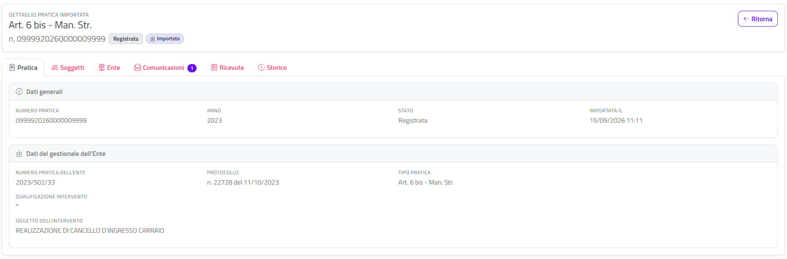

# Dettaglio della pratica importata

Questa sezione spiega come consultare il dettaglio di una **pratica importata**, cioè una pratica pregressa presente nel gestionale dell'Ente che un professionista ha collegato a GeoTecSUE.

La pagina è costruita come il [Dettaglio della pratica](dettaglio-pratica.html) delle pratiche presentate su GeoTecSUE: stessa intestazione, stesse schede in gran parte, stesso funzionamento di voltura, ricevute e pagamenti. Qui trovi descritte tutte le schede, ma per le parti identiche si rimanda a quella pagina. Le differenze sono riassunte nella sezione [Differenze rispetto al dettaglio della pratica](#differenze-rispetto-al-dettaglio-della-pratica).

{: .note }
> Una pratica importata non ha un'istanza compilata su GeoTecSUE: non esistono il PDF dell'istanza, gli allegati originali né le ricevute della pratica stessa. I documenti originali restano nel gestionale dell'Ente. In GeoTecSUE vedi i dati letti dal gestionale e tutto ciò che è successo **dopo** l'importazione (comunicazioni, integrazioni, pagamenti).

## Accedere alla pagina

1. Dal menu in alto scegli **Gestione Pratiche › Pratiche Importate** (vedi [Pratiche importate](pratiche-importate.html)).
2. Clicca sul numero della pratica o sul pulsante con la lente.

Puoi arrivarci anche da altri elenchi, ad esempio [Pratiche e comunicazioni trasmesse](pratiche-trasmesse.html): quando la pratica aperta è un'importata, il sistema mostra sempre questa pagina invece del dettaglio standard.

Se la pratica non esiste o non appartiene al tuo Ente, la pagina mostra il riquadro **Pratica non trovata** ("La pratica richiesta non esiste oppure non appartiene a questo Ente.") con il solo pulsante **Ritorna**.

## Intestazione

In alto trovi:

- la dicitura **Dettaglio pratica importata**;
- il **tipo di pratica**, come risulta dal gestionale;
- il numero della pratica in GeoTecSUE ("n. …");
- il badge colorato dello **stato** (vedi [Stati delle pratiche](appendici/stati-pratica.html));
- il badge **Importata**, che distingue a colpo d'occhio questa pagina dal dettaglio standard;
- a destra il pulsante **Ritorna**.

### Ritorna

**Ritorna** ti riporta all'elenco [Pratiche importate](pratiche-importate.html) con i filtri che avevi impostato. Se sei arrivato al dettaglio dalla pagina [Gestione protocollazione](gestione-protocollazione.html), ti riporta invece lì.

{: .note }
> Se hai aperto la pratica da [Pratiche e comunicazioni trasmesse](pratiche-trasmesse.html), **Ritorna** ti porta comunque a **Pratiche importate**, non all'elenco da cui eri partito.

## Avvisi sopra le schede

Sotto l'intestazione possono comparire, uno sotto l'altro, alcuni riquadri. Sono gli stessi del dettaglio standard, con una differenza per la richiesta di integrazioni.

### Ente non più attivo

Riquadro rosso **Questo ente non è più attivo**, con l'indicazione dell'Ente in cui è confluito ("È confluito nell'ente …"). Compare se il Comune della pratica è stato unito a un altro Ente.

### Esito della pratica

Riquadro rosso che compare quando la pratica è in uno di questi stati:

| Stato | Titolo del riquadro | Data mostrata | Motivazione |
|---|---|---|---|
| Rifiutata | **Pratica rifiutata** | **Data del rifiuto** | Sì |
| Archiviata | **Pratica archiviata** | **Data di archiviazione** | Sì |
| Diniego | **Pratica in diniego** | **Data del diniego** | No |
| Revoca del delegato | **Revoca del delegato** | **Data della revoca** | Sì |

Se la motivazione non è stata registrata, al suo posto compare un trattino.

### Richiesta di integrazioni in attesa di risposta

Se c'è una richiesta di integrazioni aperta, compare il riquadro giallo **Richiesta di integrazioni in attesa di risposta (dal gg/mm/aaaa)** con l'eventuale descrizione della richiesta e la tabella dei documenti richiesti:

| Colonna | Contenuto |
|---|---|
| **Documento richiesto** | La descrizione del documento chiesto al professionista. |
| **Caricato dal professionista** | **Caricato** (badge verde) se il professionista ha già caricato il file, altrimenti **Non ancora**. |

Il riquadro non compare se la pratica è Rifiutata, Archiviata, in Diniego, Esecutiva, Verificata, in Richiesta di archiviazione o in Revoca del delegato. È in sola lettura: il professionista risponde dal proprio portale.

{: .note }
> Nel dettaglio standard la richiesta di integrazioni sta dentro la card **Da fare su questa pratica**, insieme alla protocollazione manuale e a **Riporta allo stato precedente**. Nella pratica importata quella card non esiste: la richiesta è un riquadro a sé, con in più la colonna **Caricato dal professionista**.

## Le schede

Il contenuto è diviso in schede. Alcune compaiono solo se hanno qualcosa da mostrare. La pagina ricorda l'ultima scheda che hai aperto per ogni pratica, anche dopo un'operazione o un ricaricamento.

| Scheda | Quando compare |
|---|---|
| **Pratica** | Sempre. |
| **Soggetti** | Sempre. |
| **Ente** | Solo se la pratica ha dati di protocollo e istruttoria registrati dall'Ente. |
| **Comunicazioni** | Solo se il professionista ha inviato almeno una comunicazione collegata. Il badge indica quante sono. |
| **Ricevute** | Solo se c'è almeno una comunicazione collegata. |
| **Pagamenti** | Solo se c'è almeno un pagamento PagoPA. Il badge indica quanti sono. |
| **Storico** | Sempre. |

{: .note }
> Rispetto al dettaglio standard manca la scheda **Documenti**: la pratica importata non ha allegati propri in GeoTecSUE.

### Scheda Pratica

Contiene due card.

**Dati generali**

| Campo | Contenuto |
|---|---|
| **Numero pratica** | Il numero (chiave) della pratica in GeoTecSUE. |
| **Anno** | L'anno della pratica. |
| **Stato** | Lo stato attuale. |
| **Importata il** | Data e ora dell'importazione in GeoTecSUE. |

**Dati del gestionale dell'Ente**

È la card tipica della pratica importata: mostra i dati letti dal gestionale al momento dell'importazione.

| Campo | Contenuto |
|---|---|
| **Numero pratica dell'Ente** | Il numero della pratica nel gestionale, nella forma anno/numero/sigla (con l'eventuale suffisso dopo il trattino). |
| **Protocollo** | Numero e data di protocollo originali. |
| **Tipo pratica** | Il tipo di pratica nel gestionale. |
| **Qualificazione intervento** | La qualificazione dell'intervento. |
| **Oggetto dell'intervento** | Compare solo se valorizzato. |

Se la pratica era arrivata al gestionale da un altro portale telematico, sotto una linea compaiono anche **Portale di provenienza**, **Tipo istanza** e **Numero istanza**.

Nel dettaglio standard, invece, la scheda Pratica mostra la descrizione dell'intervento, le date di registrazione, modifica e invio, i pulsanti per scaricare l'istanza e la card **Localizzazione dell'intervento** con i dati catastali: nella pratica importata queste informazioni non ci sono.

### Scheda Soggetti

**Titolare**

Mostra il titolare come risulta dal gestionale:

- per una persona fisica, **Cognome e nome** e **Codice fiscale**;
- per una ditta o un ente, l'etichetta diventa **Legale rappresentante** e sotto compare il riquadro **Ditta / Società / Ente rappresentato** con la **Denominazione**.

A differenza del dettaglio standard non ci sono nascita, residenza, e-mail, recapiti della ditta né l'elenco degli altri titolari.

Se la pratica ha subito volture del titolare, compare la tabella **Titolari dopo voltura** (**Cognome e nome**, **Codice fiscale**, **Richiesta**, **Conferma**, **Referente PagoPA**). Cliccando sul badge **Sì**/**No** della colonna **Referente PagoPA** scegli a quale titolare sono intestati i pagamenti PagoPA: il funzionamento è lo stesso del [dettaglio standard](dettaglio-pratica.html). Anche qui la voltura del titolare non si esegue dal back office: viene registrata su Sequoia e trasmessa a GeoTecSUE (vedi [Voltura del titolare](dettaglio-pratica.html#voltura-del-titolare)). Il referente è uno solo: rendendo referente un titolare, gli altri smettono di esserlo.

**Professionista**

Mostra **Cognome e nome**, **Codice fiscale** e **Nascita** del professionista che gestisce la pratica in GeoTecSUE. Se il professionista ha indicato l'albo, compaiono anche **Iscritto all'ordine / collegio**, **Provincia** e **Numero**.

**Voltura ad altro professionista**

Puoi intestare la pratica a un altro professionista registrato presso il tuo Ente, come nel dettaglio standard:

1. Nel campo di ricerca scrivi cognome, nome o codice fiscale e scegli il professionista (il professionista attuale non è nell'elenco).
2. Clicca su **Voltura**.
3. Nella finestra **Volturare la pratica?** controlla il nome indicato sotto "La pratica passerà al professionista:".
4. Clicca su **Voltura** per confermare, oppure su **Annulla**.

La pagina si ricarica e compare la notifica verde "Pratica volturata a …". Nello **Storico** viene registrata l'operazione "Pratica Volturata da … a …" e il professionista precedente riceve un avviso nel proprio portale.

{: .warning }
> La voltura toglie la pratica al professionista attuale e la affida a quello scelto. Se la pratica era in stato **Revoca del delegato**, con la voltura torna allo stato che aveva prima della revoca.

### Scheda Ente

Compare solo se l'Ente ha registrato dati di protocollo e istruttoria sulla pratica. Il contenuto è lo stesso del [dettaglio standard](dettaglio-pratica.html):

- **Protocollo e istruttoria**: **Numero protocollo**, **Data protocollo** e, se la pratica è registrata, **Numero pratica dell'Ente** e **Registrata il**; se assegnata, **Responsabile del procedimento**, **Responsabile del servizio** e **Assegnata il**; se verificata, **Verificata il**.
- **Provvedimento** (se c'è un numero di provvedimento): **Numero provvedimento**, **Data provvedimento** e la tabella dei documenti del provvedimento (**Emesso il**, **Documento**, **Letto dal professionista**, pulsante di scarico).
- **Documenti inviati dall'Ente** (con il numero dei documenti e di quelli non ancora letti dal professionista): **Tipo** (Documento, Rilascio provvedimento, Parere), **Emesso il**, **Descrizione**, **Letto dal professionista**, pulsante di scarico. Le righe non ancora lette sono in grassetto.
- **Richieste di integrazione** (con il numero delle richieste): un elenco a fisarmonica, una voce per richiesta, con il badge **Risposta inviata** o **In attesa di risposta**. Aprendo una voce vedi **Pratica di integrazione**, **Richiesta il**, **Inviata il**, **Accettata il**, **Protocollo** e i documenti inviati dal professionista (**Accettato il**, **Documento**, **Disponibile fino al**, pulsante di scarico).
- **Agibilità**: **Numero domanda**, **Protocollo**, **Tipo** (Parziale o Totale), **Rilascio**, **Data agibilità**.

{: .note }
> Scaricare dal back office un documento inviato dall'Ente non lo segna come letto: la colonna **Letto dal professionista** riporta solo la lettura da parte del professionista.

I documenti con la data **Disponibile fino al** superata mostrano il badge "Scaduto il …" e il pulsante di scarico è disattivato.

### Scheda Comunicazioni

Elenca le comunicazioni che il professionista ha inviato sulla pratica importata dopo l'importazione (ad esempio inizio o fine lavori, integrazioni), dalla più recente. Ogni voce a fisarmonica mostra tipo, numero, data di invio, badge dello stato e numero di allegati. Aprendola trovi:

- **Inviata il** e **Protocollo** (oppure "Non ancora protocollata");
- i pulsanti **Comunicazione (PDF)** e **Firmata (P7M)**, disattivati se il file non esiste (ad esempio per un invio libero);
- la tabella degli allegati: **Inserito il**, **Allegato** (con il nome del file), **Disponibile fino al**, pulsante di scarico.

Il funzionamento è identico al [dettaglio standard](dettaglio-pratica.html).

### Scheda Ricevute

La pratica importata non ha ricevute proprie: la scheda raccoglie quelle delle **comunicazioni collegate**, una card per comunicazione (titolo "*tipo* n. *numero*"), ciascuna con due righe:

- **Ricevuta di invio**;
- **Ricevuta di protocollazione**.

| Badge | Significato | Pulsanti |
|---|---|---|
| **Disponibile** (verde) | La ricevuta è pronta. | **Rigenera**, **Scarica** |
| **In generazione** (giallo) | La comunicazione è stata inviata da meno di un'ora: ricarica la pagina tra qualche minuto. | **Rigenera** |
| **Non generata** (rosso) | La ricevuta manca. | **Rigenera** |
| **Non ancora prevista** | La comunicazione non è ancora protocollata, quindi la ricevuta di protocollazione non esiste. | Nessuno |

Clicca su **Scarica** per scaricare il PDF, oppure su **Rigenera** per crearlo di nuovo: dopo la rigenerazione la pagina si ricarica con la notifica verde "Ricevuta … rigenerata (n. …)".

{: .note }
> Nel dettaglio standard la prima card riguarda le ricevute della pratica stessa. Qui non c'è, perché la pratica è stata presentata fuori da GeoTecSUE.

### Scheda Pagamenti

Uguale al [dettaglio standard](dettaglio-pratica.html). Contiene:

- **Pagamenti da effettuare**, se il servizio PagoPA è attivo per l'Ente: **Descrizione**, **Rata**, **Scadenza**, **Importo**, **Codice IUV**, **Stato** e il pulsante **Aggiorna stato**, che rilegge da PagoPA lo stato del singolo pagamento. Se uno IUV è ancora in attesa di generazione compare l'avviso che invita ad attendere qualche minuto e usare **Aggiorna stato**.
- **Pagamenti completati**: **Descrizione**, **Rata**, **Richiesta IUV**, **Pagato il**, **Importo**, **Codice IUV**, **Stato**.

Nella descrizione, "(generato dall'Ente)" indica un pagamento creato dall'Ente e "[Comunicazione - …]" un pagamento legato a una comunicazione collegata. All'apertura della pagina lo stato dei pagamenti viene aggiornato automaticamente da PagoPA.

### Scheda Storico

- **Tracciabilità**: tabella con **Data** e **Operazione** di ogni passaggio registrato sulla pratica, dalla più recente. Per le pratiche importate con il consenso dell'Ente trovi, tra le prime operazioni, "Pratica importata da gestionale con consenso dell'Ente".
- **Interoperabilità con Regione Lombardia**: compare solo se la pratica è stata trasmessa a Regione Lombardia (vedi [Trasmissioni Regione Lombardia](trasmissioni-regione-lombardia.html)).

## Differenze rispetto al dettaglio della pratica

| Elemento | Dettaglio della pratica | Dettaglio della pratica importata |
|---|---|---|
| Badge **Importata** nell'intestazione | ❌ | ✅ |
| Pulsante **Archivio della pratica** (zip) | ✅ | ❌ |
| Pulsanti **Consenti invio libero** / **Rimuovi invio libero** | ✅ (se previsti) | ❌ |
| Card **Da fare su questa pratica** (protocollazione manuale, **Riporta allo stato precedente**) | ✅ | ❌ |
| Richiesta di integrazioni in attesa | Dentro il riquadro **Da fare su questa pratica** | Riquadro a sé, con colonna **Caricato dal professionista** |
| Scheda **Pratica** | Dati dell'istanza, pulsanti PDF/P7M, **Localizzazione dell'intervento** | **Dati generali** ridotti e **Dati del gestionale dell'Ente** |
| Scheda **Soggetti** – titolare | **Titolare originale** con recapiti e altri titolari | Solo nominativo e codice fiscale dal gestionale |
| Scheda **Documenti** | ✅ | ❌ |
| Scheda **Ricevute** | Ricevute della pratica e delle comunicazioni | Solo ricevute delle comunicazioni |
| Schede **Ente**, **Comunicazioni**, **Pagamenti**, **Storico**, voltura, referente PagoPA | ✅ | ✅ (uguali) |

## Messaggi di errore

Se una parte della pagina non si riesce a caricare, le altre vengono mostrate comunque e si apre la finestra **Attenzione** con l'elenco delle parti mancanti ("Non è stato possibile caricare: …"). Se il problema si ripete, segnala il numero della pratica all'assistenza.
