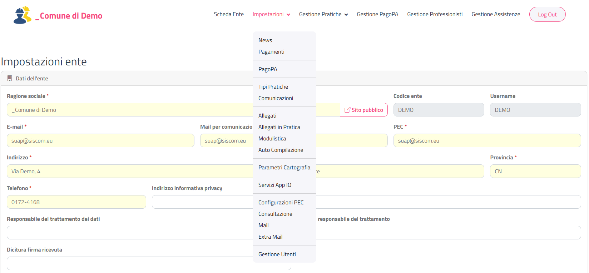
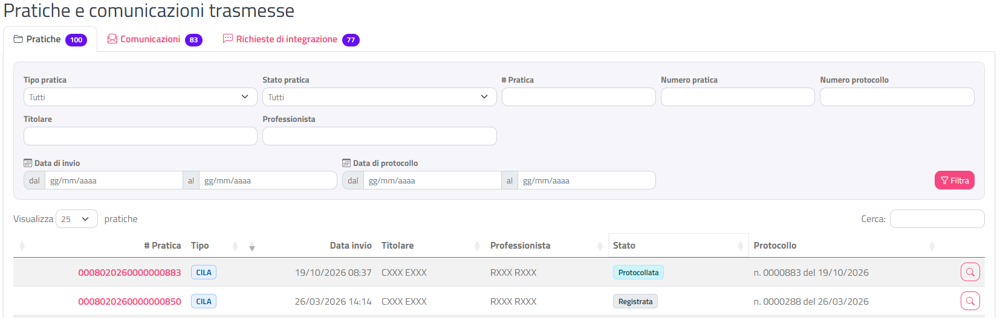
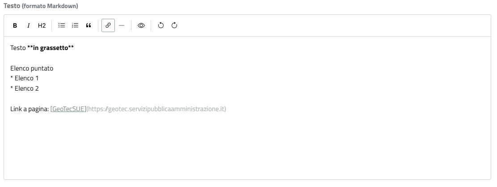

# Interfaccia e convenzioni

Questa sezione spiega com'è fatta una pagina del back office e descrive gli elementi che ritrovi in quasi tutte le pagine: menu, spinner, notifiche, finestre, tabelle, filtri, badge di stato, pulsanti ed editor di testo. Le altre pagine del manuale rimandano qui invece di ripetere queste spiegazioni.

## Struttura della pagina

Ogni pagina del back office ha tre parti:

| Parte | Contenuto |
|-------|-----------|
| **Barra in alto** | A sinistra il logo GeoTecSUE e il **nome del tuo Ente** (cliccandoci torni alla [Scheda Ente](scheda-ente.html)); a destra le voci del menu e il pulsante **Log Out**. Quando scorri la pagina verso il basso la barra resta visibile. |
| **Contenuto** | Il titolo della pagina e le card (riquadri con intestazione) con dati, tabelle e pulsanti. |
| **Piè di pagina** | L'anno, la scritta *GeoTecSue – Tutti i diritti riservati* e, a destra, **Versione** e **Data Rilascio** del back office. |

In basso a destra trovi un pulsante con la **freccia in su**: cliccalo per tornare subito all'inizio della pagina.

Su schermi stretti (tablet, finestra ridotta) le voci del menu si raccolgono sotto il pulsante con le **tre linee** in alto a destra: cliccalo per aprire il menu.

## Il menu

Le voci **Impostazioni** e **Gestione Pratiche** aprono un sottomenu; le altre aprono direttamente una pagina. Alcune voci compaiono solo se la funzione è attiva per il tuo Ente (colonna **Visibile**).

### Voci principali

| Voce di menu | A cosa serve | Visibile | Pagina del manuale |
|--------------|--------------|----------|--------------------|
| **Scheda Ente** | Dati anagrafici dell'Ente, opzioni generali del portale, logo, strumenti | Sempre | [Scheda Ente](scheda-ente.html) |
| **Gestione PagoPA** | Consultazione dei pagamenti PagoPA delle pratiche | Sempre | [Gestione PagoPA](gestione-pagopa.html) |
| **Gestione Professionisti** | Elenco dei professionisti che operano con l'Ente | Sempre | [Gestione professionisti](gestione-professionisti.html) |
| **Gestione Assistenze** | Richieste di assistenza tecnica | Sempre | [Gestione assistenze](gestione-assistenze.html) |
| **Log Out** | Uscita dal back office | Sempre | [Accesso al back office](accesso.html#uscire-dal-back-office) |

### Impostazioni

| Voce di menu | A cosa serve | Visibile | Pagina del manuale |
|--------------|--------------|----------|--------------------|
| **News** | Avvisi pubblicati sul portale dei professionisti | Sempre | [News](news.html) |
| **Pagamenti** | Pagamenti (diritti di segreteria e simili) richiesti nelle pratiche | Sempre | [Pagamenti](pagamenti.html) |
| **PagoPA** | Configurazione dei pagamenti PagoPA | Sempre | [Configurazione PagoPA](pagopa-configurazione.html) |
| **Tipi Pratiche** | Tipi di pratica attivi per l'Ente e loro impostazioni | Sempre | [Tipi pratiche](tipi-pratiche.html) |
| **Comunicazioni** | Comunicazioni che il professionista può inviare sulle pratiche | Sempre | [Comunicazioni](comunicazioni.html) |
| **Allegati** | Elenco degli allegati che l'Ente può richiedere | Sempre | [Allegati](allegati.html) |
| **Allegati in Pratica** | Allegati richiesti per ciascun tipo di pratica | Sempre | [Allegati in pratica](allegati-in-pratica.html) |
| **Modulistica** | Modelli scaricabili dai professionisti | Sempre | [Modulistica](modulistica.html) |
| **Auto Compilazione** | Compilazione automatica di dati nelle pratiche | Sempre | [Auto compilazione](autocompilazione.html) |
| **Parametri Cartografia** | Parametri della cartografia dell'Ente | Solo se per l'Ente è configurata la cartografia | [Parametri cartografia](parametri-cartografia.html) |
| **Servizi App IO** | Messaggi inviati tramite l'App IO | Sempre | [App IO](app-io.html) |
| **Configurazioni PEC** | Casella PEC usata per le notifiche | Sempre | [Configurazioni PEC](configurazioni-pec.html) |
| **Consultazione** | Consultazione online delle pratiche | Sempre | [Consultazione](consultazione.html) |
| **Mail** | Testi e impostazioni delle mail | Sempre | [Mail](mail.html) |
| **Extra Mail** | Destinatari aggiuntivi delle mail | Sempre | [Extra mail](extra-mail.html) |
| **Gestione Utenti** | Utenti dell'Ente | Sempre | [Utenti](utenti.html) |

### Gestione Pratiche

| Voce di menu | A cosa serve | Visibile | Pagina del manuale |
|--------------|--------------|----------|--------------------|
| **Pratiche e comunicazioni trasmesse** | Elenco delle pratiche e comunicazioni inviate dai professionisti | Sempre | [Pratiche trasmesse](pratiche-trasmesse.html) |
| **Pratiche Importate** | Pratiche importate dal gestionale dell'Ente | Solo se l'Ente ha attivato la possibilità di importare le pratiche pregresse | [Pratiche importate](pratiche-importate.html) |
| **Pratiche In corso** | Pratiche ancora in compilazione da parte dei professionisti | Sempre | [Pratiche in corso](pratiche-in-corso.html) |
| **Notifiche Preliminari** | Notifiche preliminari ricevute | Solo se l'Ente gestisce le notifiche preliminari | [Notifiche preliminari](notifiche-preliminari.html) |
| **Gestione Protocollazione** | Protocollazione delle pratiche da parte dell'Ente | Solo se l'Ente protocolla le pratiche senza collegamento automatico al protocollo (non ha il protocollo di **SISCOM**) | [Gestione protocollazione](gestione-protocollazione.html) |
| **Gestione Richieste Importazione** | Se l'Ente ha attivato la possibilità di importare le pratiche pregresse ma vuole dare conferma prima dell'importazione | Solo se nella [Scheda Ente](scheda-ente.html#opzioni) **Collegamento pratiche Sequoia su SUE** è **Attivo con conferma dell'Ente** | [Richieste di importazione](richieste-importazione.html) |
| **Trasmissioni Regione Lombardia** | Trasmissioni dei dati alla Regione | Solo per gli Enti della Regione Lombardia | [Trasmissioni Regione Lombardia](trasmissioni-regione-lombardia.html) |

{: .note }
> Se una voce che ti aspetti non compare, la funzione non è attiva per il tuo Ente. Per la voce **Gestione Richieste Importazione**, dopo aver cambiato l'impostazione nella Scheda Ente riapri la Scheda Ente dal menu (o esci e rientra) per aggiornare il menu.

## Spinner di caricamento

Quando una pagina si sta caricando o un'operazione è in corso, la pagina viene coperta da uno sfondo bianco con un **cerchio rosso che gira** al centro.

Lo spinner compare quando:

- apri una pagina dal menu;
- clicchi un pulsante che salva, filtra o cerca;
- cambi il valore di alcune tendine che aggiornano subito la pagina;
- generi un documento che richiede tempo (ad esempio i PDF della [Scheda Ente](scheda-ente.html#stampa-allegati)).

Non compare per i pulsanti che scaricano solo un file: il file arriva nella cartella dei download del browser e la pagina resta com'è.

{: .note }
> Attendi che lo spinner sparisca prima di cliccare altri pulsanti. Se torni indietro con il pulsante del browser, lo spinner viene nascosto automaticamente.

## Notifiche di conferma

Quando un'operazione va a buon fine compare in **alto a destra** un riquadro **verde** con il segno di spunta, ad esempio *"Impostazioni salvate"*. A volte sotto il testo principale c'è una riga di dettaglio.

La notifica sparisce da sola dopo qualche secondo; puoi chiuderla prima con la **X**.

## Finestra di errore

Quando un'operazione non riesce, o un dato non è valido, si apre al centro della pagina una finestra con titolo **Attenzione** (triangolo giallo) e il messaggio che spiega il problema. Clicca su **Chiudi** o sulla **X** per chiuderla.

Messaggi generici che puoi trovare in tutte le pagine:

| Messaggio | Cosa significa |
|-----------|----------------|
| *Si è verificato un errore durante la lettura/elaborazione dei dati* | Errore imprevisto. Riprova; se si ripete, contatta l'assistenza indicando la pagina e l'operazione. |
| *Errore API: … (Codice: …)* | Il servizio centrale ha rifiutato l'operazione. Annota il testo e il codice e comunicali all'assistenza. |

Se la sessione è scaduta non vedi la finestra di errore: vieni riportato alla scelta dell'Ente (vedi [Sessione scaduta](accesso.html#sessione-scaduta)).

## Finestre di conferma

Le operazioni importanti (eliminazioni, disattivazioni, protocollazioni, aggiornamenti) chiedono conferma in una finestra al centro della pagina. La finestra ha:

- un titolo con la domanda o l'operazione (es. **Conferma eliminazione**, **Protocollare la pratica?**);
- un testo che spiega cosa succederà;
- il pulsante grigio **Annulla**, che chiude la finestra senza fare nulla;
- il pulsante dell'operazione (es. **Elimina** rosso con il cestino, **Disattiva** rosso, **Protocolla** verde).

{: .warning }
> Leggi sempre il testo della finestra prima di confermare: eliminazioni e operazioni che inviano mail o PEC al professionista non si possono annullare.

## Tabelle

Gli elenchi (pratiche, allegati, utenti, pagamenti…) sono tabelle con funzioni comuni.

| Funzione | Come si usa |
|----------|-------------|
| **Cerca** | Scrivi nella casella **Cerca:** sopra la tabella: restano visibili solo le righe che contengono il testo in una qualsiasi colonna. La ricerca lavora sulle righe già caricate (non sostituisce i filtri). |
| **Righe per pagina** | Con la tendina **Visualizza …** scegli quante righe mostrare (di solito 25). |
| **Ordinamento** | Clicca sull'intestazione di una colonna per ordinare; clicca di nuovo per invertire l'ordine. Le date si ordinano correttamente per data, non per testo. |
| **Paginazione** | Sotto la tabella trovi **Inizio**, **Precedente**, i numeri di pagina, **Successivo**, **Fine**. A sinistra il riepilogo, es. *Da 1 a 25 di 130 pratiche*. |
| **Valori mancanti** | Una cella vuota è mostrata con un trattino **—**. |
| **Apertura del dettaglio** | Clicca sul numero della pratica (in grassetto) o sul pulsante con la **lente** a destra della riga. |

Se la ricerca non trova nulla compare *"La ricerca non ha portato alcun risultato."*

### Memoria della tabella

Nella maggior parte degli elenchi la tabella ricorda **pagina, ordinamento e testo di ricerca** finché la scheda del browser resta aperta. Quando apri un dettaglio e torni all'elenco ritrovi la tabella come l'avevi lasciata. Chiudendo la scheda del browser la tabella torna all'impostazione iniziale.

## Card dei filtri

Gli elenchi delle pratiche hanno in alto una card con i **filtri** (riquadro grigio con i campi di ricerca).

1. Compila uno o più campi (tipo pratica, stato, numero, titolare, date…).
2. Clicca su **Filtra** (icona a imbuto) oppure premi Invio in un campo.

Dopo il filtro:

- nell'intestazione della card compare un badge **giallo** con il numero di filtri attivi (es. **2 filtri**);
- accanto al titolo, il badge **grigio** indica quante righe sono state trovate;
- compare il pulsante **Rimuovi filtri** (icona con la X), che svuota tutti i campi e ricarica l'elenco completo.

I campi data si compilano scrivendo nel formato **gg/mm/aaaa** oppure scegliendo il giorno nel calendario che si apre cliccando nel campo. Gli intervalli hanno due campi **dal** e **al**.

{: .note }
> I filtri restano impostati quando apri il dettaglio di una pratica e torni all'elenco con **Ritorna**. Se invece riapri la pagina dal menu, i filtri vengono azzerati.

## Pagine di dettaglio

Le pagine di dettaglio (pratica, pratica importata, notifica preliminare) hanno in alto una card di intestazione con:

- il tipo di pratica e il numero;
- il badge colorato dello stato;
- il pulsante **Ritorna** (freccia a sinistra), che riporta all'elenco da cui sei partito con i filtri che avevi impostato.

Il resto delle informazioni è diviso in **schede** (es. **Pratica**, **Soggetti**, **Documenti**, **Ente**, **Comunicazioni**, **Ricevute**, **Pagamenti**, **Storico**): clicca sul nome di una scheda per aprirla. Il back office ricorda l'ultima scheda aperta per ciascuna pratica finché la scheda del browser resta aperta. I dettagli sono descritti in [Dettaglio della pratica](dettaglio-pratica.html).

{: .note }
> Usa **Ritorna** invece del pulsante "Indietro" del browser: così l'elenco viene ricaricato con i filtri e i dati aggiornati.

## Badge di stato

Lo stato di pratiche e comunicazioni è mostrato con un **badge colorato**, uguale in tutti gli elenchi e nei dettagli. Il colore aiuta a individuare a colpo d'occhio cosa richiede attenzione.

| Colore | Stati | Significato |
|--------|-------|-------------|
| **Arancione** | Inviata, Inviata SPRESALWEB | Arrivata all'Ente, da prendere in carico sul gestionale **Sequoia** (non nel caso di SPRESALWEB) |
| **Azzurro** | Protocollata | Protocollata, in lavorazione |
| **Giallo** | Richiesta Integrazioni, Richiesta Archiviazione, Invio Integrazioni | In attesa di un'azione (del professionista o dell'Ente) |
| **Verde** | Esecutiva, Verificata, Protocollata SPRESALWEB | Conclusa positivamente |
| **Rosso** | Archiviata, Diniego, Rifiutata, Revoca Delegato | Chiusa negativamente o non più attiva |
| **Grigio** | Registrata e gli altri stati | Nessuna segnalazione particolare |

Il significato di ogni stato è spiegato in [Stati delle pratiche](appendici/stati-pratica.html).

### Altri badge

| Badge | Dove lo trovi | Significato |
|-------|---------------|-------------|
| **Disponibile** (verde) / **In generazione** (giallo) / **Non generata** (rosso) / **Non ancora prevista** (neutro) | Ricevute nei dettagli | Stato della ricevuta. Passa il mouse sul badge per una spiegazione. |
| **Sì** (verde) / **No** (chiaro) cliccabili | Impostazioni (es. allegati, comunicazioni, consultazione) | Indicano se un'opzione è attiva. Clicca sul badge per invertirla: la modifica viene salvata subito. |
| Badge grigio con numero o con graffetta | Elenchi e intestazioni | Conteggi (righe trovate, numero di allegati). |
| **N filtri** (giallo) | Card dei filtri | Numero di filtri attivi. |
| **Scaduto il gg/mm/aaaa** (grigio) | Documenti nei dettagli | Il documento non è più scaricabile. |

## Pulsanti e icone ricorrenti

I pulsanti hanno un'icona e, quasi sempre, un testo. Passando il mouse sopra un pulsante compare un suggerimento che descrive l'azione.

| Icona | Colore tipico | Azione |
|-------|---------------|--------|
| Matita | Blu (bordo) | Modifica l'elemento della riga (apre una finestra di modifica) |
| Cestino | Rosso (bordo) | Elimina; chiede sempre conferma |
| Cestino | Grigio, disattivato | Eliminazione non possibile (es. elemento in uso): il suggerimento spiega il motivo |
| Cerchio barrato | Rosso | Disattiva l'elemento (es. un tipo di pratica o un allegato per una pratica) |
| Lente | Blu (bordo) | Apri il dettaglio |
| Più (+) | Blu | **Nuovo …**: aggiunge un elemento (es. **Nuovo allegato**, **Nuovo pagamento**) |
| Dischetto | Verde | **Salva** |
| Freccia circolare all'indietro | Grigio | Annulla le modifiche e ricarica i dati salvati |
| Imbuto | Blu | **Filtra** |
| X nel cerchio | Grigio | **Rimuovi filtri** |
| Freccia a sinistra | Grigio | **Ritorna** all'elenco |
| Freccia verso il basso | Grigio o blu | Scarica un file |
| Documento PDF | Rosso o grigio | Scarica/apri un PDF |
| Freccia verso l'alto | Blu | Carica un file |
| Occhio | Grigio | Mostra la password o l'anteprima |
| Graffetta | Grigio | Allegati |

{: .note }
> Rispetto al portale dei professionisti, nel back office il pulsante di modifica (matita) è **blu** e non giallo.

## Editor di testo (Markdown)

Nelle pagine [News](news.html), [Pagamenti](pagamenti.html) e [Servizi App IO](app-io.html) i testi lunghi si scrivono in un editor con una barra di pulsanti. Il testo viene salvato in formato **Markdown** (testo semplice con simboli per la formattazione, es. `**grassetto**`).

| Pulsante | Effetto |
|----------|---------|
| **B** (Grassetto) | Mette in grassetto il testo selezionato |
| *I* (Corsivo) | Mette in corsivo |
| **H2** (Titolo) | Trasforma la riga in un titolo |
| Elenco puntato / Elenco numerato | Crea un elenco |
| Citazione | Crea un blocco citato (solo News e Pagamenti) |
| Link | Inserisce un collegamento; ti chiede l'*Indirizzo del link* |
| Linea orizzontale | Inserisce una riga di separazione (solo News e Pagamenti) |
| Occhio (Anteprima) | Mostra il testo come apparirà; clicca di nuovo per tornare alla scrittura |
| Annulla / Ripeti | Annulla o ripete l'ultima modifica |

## Date

Tutte le date si leggono e si scrivono nel formato **gg/mm/aaaa** (es. 05/03/2026). Nei campi data puoi scrivere la data oppure sceglierla nel calendario; il giorno di oggi è evidenziato.

---

**Prossimi passi**: apri la [Scheda Ente](scheda-ente.html) per controllare i dati e le opzioni generali del tuo Ente.
