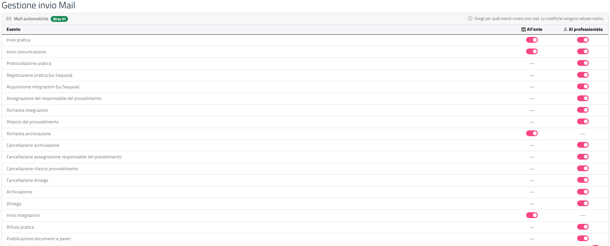

# Mail

Questa sezione spiega come scegliere per quali eventi delle pratiche GeoTecSUE invia una mail automatica, e se la mail va all'Ente, al professionista o a entrambi.

## Accedere alla pagina

Dal menu in alto scegli **Impostazioni › Mail**. La pagina si intitola **Gestione invio Mail**.

## Come funzionano le mail automatiche

Quando su una pratica avviene un evento (ad esempio l'invio da parte del professionista o la protocollazione), GeoTecSUE può inviare un messaggio:

- **All'ente**: una mail all'indirizzo dell'Ente, per avvisare l'ufficio dell'evento (ad esempio una nuova pratica arrivata). Le stesse mail rivolte all'Ente possono essere inviate in copia agli indirizzi aggiuntivi configurati in [Extra Mail](extra-mail.html). <!-- DA VERIFICARE: indirizzo Ente usato (campo "E-mail" della Scheda Ente) e se la copia agli Extra Mail vale per tutti gli eventi "All'ente" o solo per alcuni -->
- **Al professionista**: un messaggio al professionista che ha presentato la pratica, per informarlo dell'evento (ad esempio che la pratica è stata protocollata).

Per i messaggi al professionista, il canale dipende dal campo **Tipo notifica** della [Scheda Ente](scheda-ente.html):

| Tipo notifica | Cosa riceve il professionista |
|---------------|-------------------------------|
| **Mail normale** | Una mail al suo indirizzo email. |
| **PEC** | Una PEC al suo indirizzo PEC, inviata dalla casella configurata in [Configurazioni PEC](configurazioni-pec.html). |
| **Entrambe** | Sia la mail sia la PEC. |

Il mittente delle mail normali è l'indirizzo dell'Ente oppure, in base alla configurazione dell'Ente, un indirizzo del servizio GeoTecSUE. <!-- DA VERIFICARE: opzione che fa usare l'indirizzo del fornitore come mittente -->

{: .note }
> Questa pagina decide solo **se** la mail parte per un certo evento. Il testo dei messaggi è predefinito e non si modifica qui. Le notifiche che il professionista vede nel portale non dipendono da queste impostazioni. <!-- DA VERIFICARE: conferma che le notifiche interne al portale vengono registrate comunque -->

## Le mail sono un servizio di cortesia

{: .warning }
> Le mail automatiche, come le notifiche sul portale, sono un **servizio di cortesia**: **non sono necessarie perché un'azione sulla pratica sia valida**. Una protocollazione, una richiesta di integrazioni o il rilascio di un provvedimento sono validi e visibili sul portale anche se la mail non arriva.

GeoTecSUE invia la mail, ma **non può sapere se verrà consegnata**. Se il professionista ha indicato un indirizzo sbagliato, oppure ha la casella piena, il messaggio non viene consegnato e il sistema **non riceve alcun avviso di errore**.

Se un professionista segnala di non aver ricevuto una mail:

- invitalo a controllare la pratica sul portale, dove trova comunque lo stato aggiornato;
- chiedigli di verificare che l'indirizzo email indicato sia corretto, che la casella non sia piena e che la mail non sia finita nella posta indesiderata.

{: .note }
> Non è utile chiedere all'assistenza se il sistema delle mail funziona o se una mail è arrivata: si può solo confermare che la mail è **partita**, non se è stata **consegnata**.

## La tabella degli eventi

La scheda **Mail automatiche** contiene una tabella con un evento per riga. Accanto al titolo un badge verde indica quanti invii sono attivi rispetto a quelli possibili (es. "12 su 31": in totale gli invii possibili sono 31).

| Colonna | Contenuto |
|---------|-----------|
| **Evento** | Nome dell'evento della pratica. |
| **All'ente** | Interruttore: acceso = la mail all'Ente viene inviata. |
| **Al professionista** | Interruttore: acceso = la mail al professionista viene inviata. |

Se in una cella compare un trattino (**—**) la mail per quel destinatario non è prevista per quell'evento e non si può attivare.

### Attivare o disattivare un invio

1. Individua la riga dell'evento.
2. Clicca sull'interruttore nella colonna **All'ente** o **Al professionista**.
3. La modifica viene salvata subito: compare la notifica verde **Invio mail attivato** oppure **Invio mail disattivato**, con il nome dell'evento e il destinatario.

Se il salvataggio non riesce compare la finestra **Attenzione** e la tabella torna a mostrare lo stato effettivamente salvato.

{: .note }
> Un evento che non hai mai configurato risulta con gli interruttori spenti: per quell'evento non parte alcuna mail finché non lo attivi.

{: .warning }
> Attivando un invio **Al professionista**, da quel momento ogni pratica che raggiunge quell'evento genera un messaggio verso il professionista (mail e/o PEC secondo il **Tipo notifica**). Verifica di aver configurato correttamente la [casella PEC](configurazioni-pec.html) se usi la PEC.

## Elenco degli eventi

| Evento | All'ente | Al professionista |
|--------|:--------:|:-----------------:|
| Invio pratica | ✅ | ✅ |
| Invio comunicazione | ✅ | ✅ |
| Protocollazione pratica | ❌ | ✅ |
| Registrazione pratica (su Sequoia) | ❌ | ✅ |
| Acquisizione integrazioni (su Sequoia) | ❌ | ✅ |
| Assegnazione del responsabile del procedimento | ❌ | ✅ |
| Richiesta integrazioni | ❌ | ✅ |
| Rilascio del provvedimento | ❌ | ✅ |
| Richiesta archiviazione | ✅ | ❌ |
| Cancellazione archiviazione | ❌ | ✅ |
| Cancellazione assegnazione responsabile del procedimento | ❌ | ✅ |
| Cancellazione rilascio provvedimento | ❌ | ✅ |
| Cancellazione diniego | ❌ | ✅ |
| Archiviazione | ❌ | ✅ |
| Diniego | ❌ | ✅ |
| Invio integrazioni | ✅ | ❌ |
| Rifiuto pratica | ❌ | ✅ |
| Pubblicazione documenti e pareri | ❌ | ✅ |
| Agibilità: registrazione | ❌ | ✅ |
| Agibilità: rilascio | ❌ | ✅ |
| Agibilità: cancellazione | ❌ | ✅ |
| Agibilità: cancellazione assegnazione | ❌ | ✅ |
| Verifica pratica | ❌ | ✅ |
| Verifica pratica: cancellazione | ❌ | ✅ |
| Revoca delegato | ❌ | ✅ |
| Invio IUV da portale a ente | ✅ | ✅ |
| Invio IUV da ente a portale | ❌ | ✅ |
| Importazione diretta istanza | ✅ | ❌ |

✅ = mail prevista (attivabile); ❌ = mail non prevista (trattino nella tabella).

In sintesi:

- Gli eventi con mail **All'ente** sono quelli avviati dal professionista (invio di pratiche, comunicazioni e integrazioni, richiesta di archiviazione, generazione di un IUV dal portale) o l'importazione diretta di un'istanza: servono ad avvisare l'ufficio che c'è qualcosa da lavorare.
- Gli eventi con mail **Al professionista** sono quelli che derivano dal lavoro dell'Ente (protocollazione, registrazione, richiesta integrazioni, provvedimenti, archiviazioni, dinieghi, verifiche, agibilità e relative cancellazioni): servono a tenere informato il professionista sull'avanzamento.

Per il significato degli stati vedi [Stati delle pratiche](appendici/stati-pratica.html).

{: .note }
> Gli eventi che riportano "(su Sequoia)" avvengono nel gestionale Sequoia collegato a GeoTecSUE e vengono poi riportati sulla pratica.

## Altre impostazioni collegate

- [Extra Mail](extra-mail.html): indirizzi aggiuntivi che ricevono in copia le mail rivolte all'Ente.
- [Configurazioni PEC](configurazioni-pec.html): casella da cui partono le PEC.
- [Scheda Ente](scheda-ente.html): **Tipo notifica** (mail, PEC o entrambe) e indirizzi dell'Ente.
