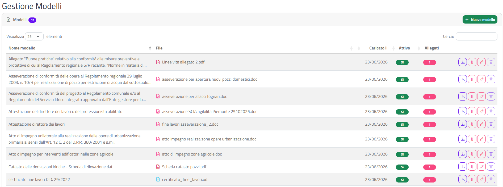
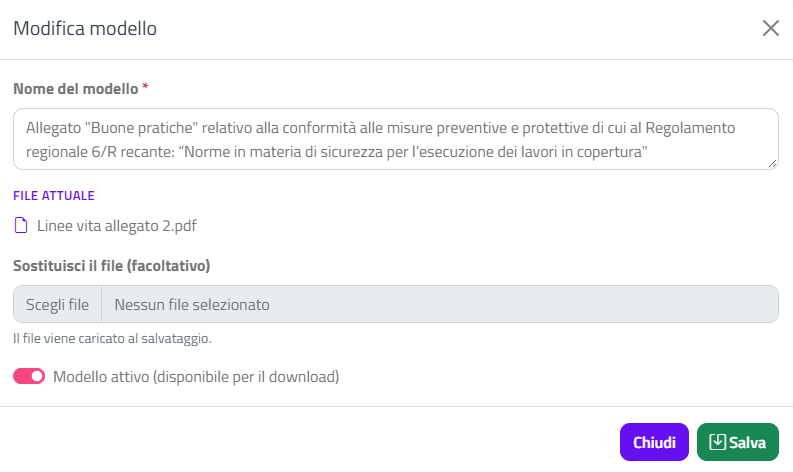
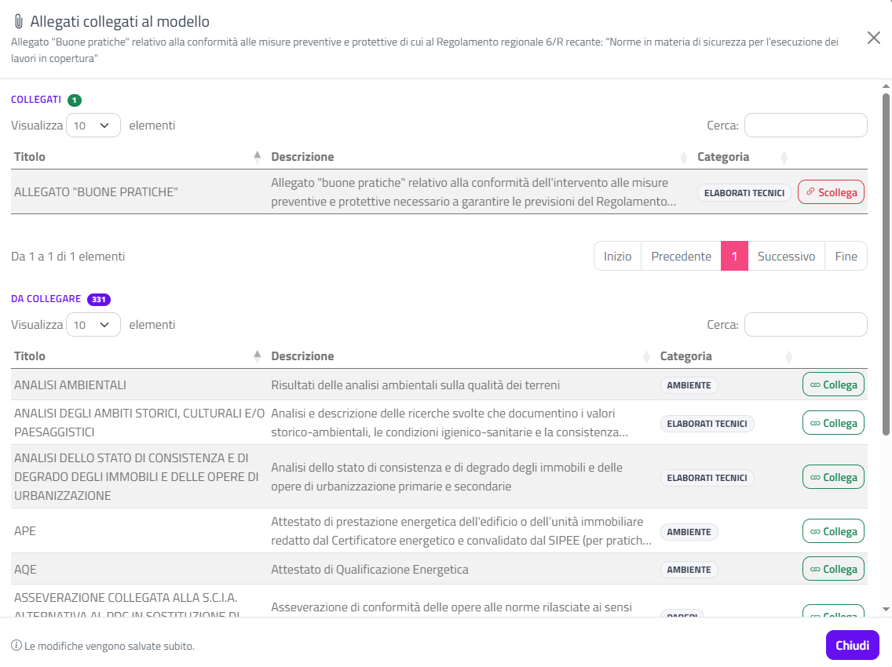

# Modulistica

Questa sezione spiega come gestire i **modelli** dell'Ente: i file (moduli, fac-simile, dichiarazioni) che metti a disposizione per il download e che puoi collegare ai tipi di allegato.

## I modelli dell'istanza NON sono in questa pagina

{: .warning }
> **In questa pagina non ci sono, e non devono esserci, i modelli dell'istanza** (ad esempio il modulo della SCIA, della CILA o del Permesso di costruire).
>
> L'istanza si compila **esclusivamente online** sul portale GeoTecSUE: il professionista inserisce i dati nella pratica e il portale genera il documento dell'istanza. Non esiste un modello dell'istanza da scaricare, compilare a mano e caricare.
>
> La modulistica serve solo per i **modelli dei documenti da allegare** alla pratica (dichiarazioni, asseverazioni, fac-simile, schede…), collegati ai tipi di allegato. Non caricare qui i moduli dell'istanza: i professionisti potrebbero pensare di poterli usare al posto della compilazione online.

## Accedere alla pagina

Dal menu in alto scegli **Impostazioni › Modulistica**. Si apre la pagina **Gestione Modelli**.

## L'elenco dei modelli

Il riquadro **Modelli** mostra tutti i modelli del tuo Ente; il badge accanto al titolo ne indica il totale. La tabella è ordinata per nome, mostra 25 righe per pagina e ricorda ricerca e pagina dopo ogni operazione (vedi [Interfaccia e convenzioni](interfaccia-e-convenzioni.html)).

| Colonna | Contenuto |
|---------|-----------|
| **Nome modello** | Il nome con cui il modello viene presentato |
| **File** | Nome del file caricato, con un'icona che ne indica il tipo (PDF, Word, Excel…) |
| **Caricato il** | Data dell'ultimo caricamento del file |
| **Attivo** | Badge **Sì** (verde) o **No** (grigio), cliccabile |
| **Allegati** | Numero di tipi di allegato collegati al modello, in un badge rosso cliccabile |
| (pulsanti) | Scarica, allegati collegati, modifica, elimina |

### Pulsanti di riga

| Pulsante | Azione |
|----------|--------|
| Freccia in basso (**Scarica il file**) | Scarica il file del modello sul tuo computer |
| Graffetta (**Allegati collegati**) | Apre la finestra per collegare il modello ai tipi di allegato |
| Matita (**Modifica il modello**) | Apre la finestra di modifica |
| Cestino (**Elimina il modello**) | Elimina il modello; è grigio e disattivato se il modello è collegato ad almeno un allegato |

Se il file non è più disponibile, il download mostra il messaggio "Il file del modello non è disponibile."

## Attivare o disattivare un modello

Clicca sul badge nella colonna **Attivo**: il valore si inverte e compare la notifica "Modello attivato" o "Modello disattivato".

Un modello attivo è **disponibile per il download**; uno disattivato resta nell'elenco ma non viene proposto.

## Aggiungere un nuovo modello

1. Clicca su **Nuovo modello**, in alto a destra nel riquadro **Modelli**.
2. Nella finestra **Nuovo modello** compila:

   | Campo | Contenuto |
   |-------|-----------|
   | **Nome del modello** (obbligatorio) | Il nome descrittivo del modello |
   | **File del modello** (obbligatorio) | Il file da caricare, scelto dal tuo computer |
   | **Modello attivo (disponibile per il download)** | Interruttore, acceso per default |

3. Clicca su **Salva**.

Il file viene caricato solo al salvataggio. Se manca il nome o il file compare la finestra **Attenzione** ("Inserire il nome del modello." oppure "Scegliere il file del modello."); chiudendola torni alla finestra del modello. A salvataggio riuscito compare la notifica **Modello creato**.

## Modificare un modello

1. Clicca sulla **matita** nella riga del modello.
2. Nella finestra **Modifica modello** puoi:
   - cambiare il **Nome del modello**;
   - vedere il nome del file in **File attuale**;
   - caricare un nuovo file in **Sostituisci il file (facoltativo)**;
   - accendere o spegnere **Modello attivo (disponibile per il download)**.
3. Clicca su **Salva**: compare la notifica **Modello salvato**.

Se carichi un nuovo file, la data **Caricato il** si aggiorna e il file precedente viene sostituito.

{: .warning }
> Il file precedente viene eliminato e non si può recuperare: se ti serve, scaricalo prima con il pulsante **Scarica il file**.

## Collegare il modello agli allegati

Un modello può essere collegato a uno o più tipi di allegato del [catalogo allegati](allegati.html).

1. Clicca sulla **graffetta** nella riga del modello, oppure sul numero nella colonna **Allegati**.
2. Si apre la finestra **Allegati collegati al modello**, con il nome del modello sotto il titolo. Contiene due tabelle (10 righe per pagina, con **Cerca**):
   - **Collegati**: gli allegati già collegati, con il pulsante **Scollega**;
   - **Da collegare**: gli altri allegati dell'Ente, con il pulsante **Collega**.
3. Clicca su **Collega** o **Scollega** nella riga desiderata. L'allegato passa da una tabella all'altra e compare la notifica "Allegato collegato al modello" o "Allegato scollegato dal modello".
4. Clicca su **Chiudi** quando hai finito.

Le modifiche vengono salvate subito; il numero nella colonna **Allegati** dell'elenco si aggiorna. Scollegare un allegato elimina solo il collegamento: l'allegato e il modello restano.

## Eliminare un modello

Puoi eliminare un modello solo se non è collegato a nessun allegato (colonna **Allegati** a 0). Altrimenti il cestino è disattivato: passando il mouse sopra leggi a quanti allegati è collegato. Scollegali prima dalla finestra **Allegati collegati al modello**.

1. Clicca sul **cestino** rosso nella riga del modello.
2. Nella finestra **Eliminare il modello?** controlla il nome mostrato.
3. Clicca su **Elimina**: compare la notifica **Modello eliminato**.

{: .warning }
> L'operazione non si può annullare.

## Pagine collegate

- [Allegati](allegati.html): il catalogo dei tipi di allegato a cui collegare i modelli.
- [Autocompilazione](autocompilazione.html): i modelli che il professionista può generare già compilati.
