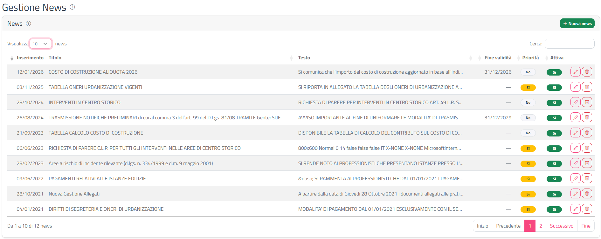
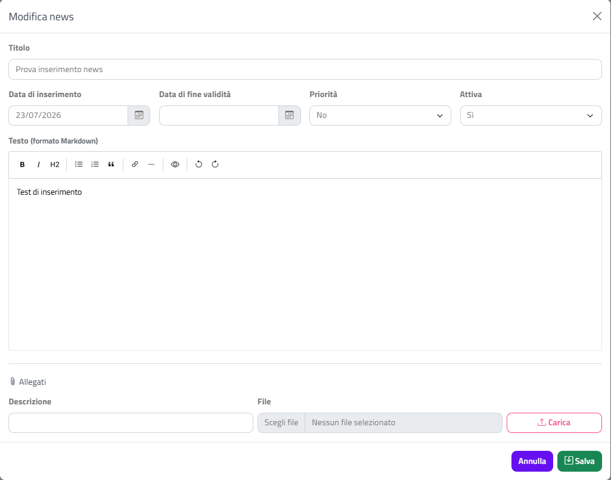

# News

Questa sezione spiega come gestire le news dell'Ente: crearle, scriverne il testo, allegare documenti, attivarle o disattivarle, metterle in priorità ed eliminarle.

## A cosa servono

Le news sono brevi comunicazioni dell'Ente (avvisi, novità sul procedimento, chiusure dell'ufficio, nuova modulistica) composte da un titolo, un testo formattato ed eventuali allegati.

Dal punto di vista del professionista, le news **attive** sono pubblicate sul portale dei professionisti; quelle con **Priorità** attiva sono messe in evidenza rispetto alle altre e quelle con una **Data di fine validità** smettono di essere mostrate dopo quella data.

## Accedere alla pagina

Dal menu in alto scegli **Impostazioni › News**.

Si apre la pagina **Gestione News** con l'elenco delle news dell'Ente.

## Elenco delle news

L'elenco mostra 10 news per pagina; per scorrere le pagine usa i numeri e le frecce **<<** e **>>** sotto la tabella. Questo elenco non ha la casella **Cerca** e non si ordina cliccando sulle colonne.

Se l'Ente non ha ancora inserito news, al posto della tabella compare il messaggio **Nessuna news presente**.

| Colonna | Contenuto |
|---------|-----------|
| **Inserimento** | Data di inserimento della news |
| **Titolo** | Titolo della news |
| **Testo** | Inizio del testo, senza formattazione. Passa con il mouse sopra il testo per leggerne una parte più lunga |
| **Fine validità** | Data di fine validità, se impostata |
| **Priorità** | Badge **Sì** (giallo) o **No** (grigio) cliccabile |
| **Attiva** | Badge **Sì** (verde) o **No** (grigio) cliccabile |
| **Azioni** | Matita (modifica) e cestino (elimina) |

### Attivare o disattivare una news

1. Clicca sul badge nella colonna **Attiva**.
2. Il valore passa da **Sì** a **No** o viceversa e la modifica viene salvata subito.

Compare la notifica **News attivata** oppure **News disattivata** con il titolo della news.

### Attivare o togliere la priorità

1. Clicca sul badge nella colonna **Priorità**.
2. Il valore passa da **Sì** a **No** o viceversa e la modifica viene salvata subito.

Compare la notifica **Priorità attivata** oppure **Priorità disattivata**.

{: .note }
> Disattivare una news è un'alternativa sicura all'eliminazione: la news resta nell'elenco e puoi riattivarla in qualsiasi momento.

## Creare una news

1. Clicca su **Nuova news** in alto a destra nell'elenco.
2. Si apre la finestra **Nuova news**: compila i campi (vedi la tabella sotto).
3. Scrivi il testo nell'editor.
4. Clicca su **Salva**.

La pagina si ricarica e compare la notifica **News creata**, con l'indicazione che ora puoi aggiungere gli allegati da **Modifica**.

{: .note }
> Gli allegati si possono aggiungere solo a una news già salvata: nella finestra **Nuova news** la sezione **Allegati** mostra il messaggio **Salva la news per poter aggiungere allegati.** Dopo il primo salvataggio, riapri la news con la matita per caricare i file.

### Campi della finestra

| Campo | Obbligatorio | Note |
|-------|--------------|------|
| **Titolo** | ✅ | Massimo 200 caratteri |
| **Data di inserimento** | ✅ | Proposta con la data di oggi; puoi cambiarla scrivendola (gg/mm/aaaa) o con il calendario |
| **Data di fine validità** | ❌ | Lasciala vuota se la news non ha una scadenza |
| **Priorità** | ❌ | **Sì** / **No** (predefinito **No**) |
| **Attiva** | ❌ | **Sì** / **No** (predefinito **Sì**) |
| **Testo** | ❌ | Testo in formato Markdown, scritto con l'editor |

Se un controllo non è superato, compare la finestra **Attenzione** con uno di questi messaggi:

| Messaggio | Causa |
|-----------|-------|
| **Necessario inserire una data valida** | Data di inserimento vuota o non valida, oppure data di fine validità non valida |
| **Necessario inserire un titolo** | Titolo vuoto |
| **Il titolo non può superare i 200 caratteri** | Titolo troppo lungo |

{: .warning }
> Quando compare un errore la finestra di modifica si chiude e il testo scritto nell'editor non viene conservato. Per i testi lunghi, copia il testo prima di cliccare su **Salva**, così puoi incollarlo di nuovo se serve.

### Scrivere il testo

Il campo **Testo** è un editor di testo in formato Markdown. La barra degli strumenti offre questi pulsanti (il nome compare passando con il mouse sopra l'icona):

| Pulsante | Effetto |
|----------|---------|
| **Grassetto**, **Corsivo** | Formattazione del testo selezionato |
| **Titolo** (H2) | Trasforma la riga in un titolo |
| **Elenco puntato**, **Elenco numerato** | Crea un elenco |
| **Citazione** | Rientra il testo come citazione |
| **Link** | Chiede l'**Indirizzo del link:** e lo inserisce |
| **Linea orizzontale** | Inserisce una linea di separazione |
| **Anteprima** | Mostra il testo come apparirà formattato; clicca di nuovo per tornare alla scrittura |
| **Annulla**, **Ripeti** | Annulla o ripete l'ultima modifica |

## Modificare una news

1. Clicca sulla matita nella colonna **Azioni**.
2. Si apre la finestra **Modifica news** con i dati salvati.
3. Modifica i campi e il testo.
4. Clicca su **Salva**.

Compare la notifica **News salvata**. Per chiudere senza salvare clicca su **Annulla** o sulla **X**.

## Allegati della news

La sezione **Allegati** è disponibile nella finestra **Modifica news**.

### Caricare un allegato

1. Scrivi la **Descrizione** del file.
2. In **File** seleziona il documento dal tuo computer.
3. Clicca su **Carica**.

Il file compare nell'elenco sotto, con la descrizione e il nome del file, e compare la notifica **Allegato caricato**.

{: .warning }
> Il caricamento di un allegato ricarica il testo della news com'era all'ultimo salvataggio: le modifiche al testo non ancora salvate vanno perse. Salva prima il testo, poi riapri la news e carica gli allegati.

Possibili messaggi di errore:

| Messaggio | Causa |
|-----------|-------|
| **ATTENZIONE ! Descrizione non inserita.** | Manca la descrizione |
| **ATTENZIONE ! Selezionare il file.** | Non hai scelto alcun file |
| **ATTENZIONE ! Dimensione del file superiore a … MB.** | Il file supera il limite di dimensione impostato nella [Scheda Ente](scheda-ente.html) (**Limite dimensione file**) |
| **ATTENZIONE: Procedere con il salvataggio prima di allegare i file.** | La news non è ancora stata salvata |

### Scaricare o eliminare un allegato

A destra di ogni allegato trovi due pulsanti:

- **Scarica il file** (freccia verso il basso): scarica il documento sul tuo computer.
- **Elimina il file** (cestino): elimina subito l'allegato, senza ulteriore conferma. Compare la notifica **Allegato eliminato**.

{: .warning }
> L'eliminazione di un allegato è immediata e non chiede conferma.

## Eliminare una news

1. Clicca sul cestino nella colonna **Azioni**.
2. Si apre la finestra **Conferma eliminazione** con il messaggio **Eliminare definitivamente la news:** seguito dal titolo.
3. Clicca su **Elimina** per confermare, oppure su **Annulla**.

Compare la notifica **News eliminata**.

{: .warning }
> L'eliminazione è definitiva. Se vuoi solo nascondere la news, usa il badge **Attiva** e impostalo su **No**.

## Messaggi e notifiche

Le notifiche verdi di conferma e la finestra **Attenzione** per gli errori seguono le convenzioni comuni del back office, descritte in [Interfaccia e convenzioni](interfaccia-e-convenzioni.html).
