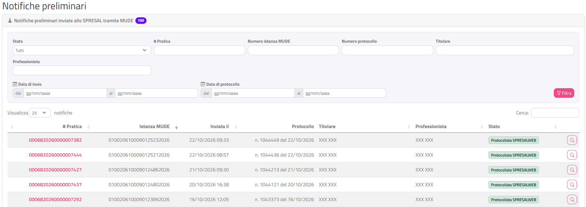

# Notifiche preliminari

Questa sezione spiega come consultare l'elenco delle **notifiche preliminari** di avvio lavori nei cantieri edili (art. 99 del D.Lgs. 81/2008) che i professionisti hanno trasmesso tramite GeoTecSUE.

La funzione riguarda gli Enti della **Regione Piemonte** che hanno attivato la trasmissione della notifica preliminare su GeoTecSUE. La notifica non è destinata all'Ente: GeoTecSUE la trasmette a **MUDE Piemonte**, che la inoltra allo **SPRESAL** dell'ASL competente, che la protocolla. L'Ente non la gestisce e non interviene nel suo iter: può solo **consultarla** da queste pagine.

Per il lato professionista vedi, nel manuale dei professionisti, la pagina "Notifica Preliminare (Piemonte)".

{: .note }
> Il numero di protocollo che vedi per una notifica preliminare è quello dello SPRESAL, assegnato tramite MUDE, non il protocollo del tuo Ente.

## Attivare la notifica preliminare

La trasmissione della notifica preliminare **non si attiva dal back office**: va prima autorizzata da **CSI Piemonte**, che gestisce MUDE Piemonte. Finché non è autorizzata, nella pagina [Tipi pratiche](tipi-pratiche.html#pratiche-non-attivabili) la Notifica Preliminare compare tra le pratiche disattive con il badge **Non attivabile** (*"Occorre prima attivare la trasmissione al MUDE."*).

### 1. Inviare la richiesta a CSI Piemonte

Il **responsabile del settore** dell'Ente invia una mail con questi dati:

- **A:** assistenza.mudepiemonte@csi.it
- **Cc:** sequoia@siscom.eu
- **Oggetto:** *Richiesta di invio della Notifica Preliminare alle AASSLL del Piemonte attraverso front end di sistemi di terze parti*

Nel testo della mail devono essere indicati:

- la **volontà di partire in produzione**;
- la **società con cui attivare il servizio**: SISCOM;
- il **referente del sistema informativo dell'Ente**, con nome e cognome, indirizzo e-mail e codice fiscale.

Esempio di testo, da completare con i dati dell'Ente:

```text
Oggetto: Richiesta di invio della Notifica Preliminare alle AASSLL del Piemonte attraverso front end di sistemi di terze parti

Con la presente il Comune di ......................... comunica la volontà di partire in produzione
con l'invio della Notifica Preliminare alle AASSLL del Piemonte attraverso il front end di sistemi
di terze parti.

Società con cui attivare il servizio: SISCOM S.p.A.

Referente del sistema informativo dell'Ente:
- Nome e cognome: .........................
- E-mail: .........................
- Codice fiscale: .........................

Il Responsabile del Settore
.........................
```

### 2. I passaggi successivi

1. **CSI Piemonte** avvia la procedura per la richiesta delle credenziali.
2. **CSI Piemonte** vi contatta per definire la data di avvio.
3. **SISCOM** configura GeoTecSUE con le credenziali fornite da CSI Piemonte e conferma la data di avvio in produzione.

### 3. Attivare la pratica

Da quel momento la notifica preliminare è **attivabile**: nella pagina [Tipi pratiche](tipi-pratiche.html#attivare-una-pratica), card **Pratiche disattive**, clicca su **Attiva** nella riga della Notifica Preliminare. Da allora i professionisti possono presentarla e nel menu compare la voce **Gestione Pratiche › Notifiche Preliminari**.

## Accedere alla pagina

Dal menu in alto scegli **Gestione Pratiche › Notifiche Preliminari**.

La voce di menu compare solo se la notifica preliminare è abilitata per il tuo Ente. Se non la vedi, la funzione non è attiva.

La pagina si intitola **Notifiche preliminari** e contiene un'unica scheda, **Notifiche preliminari inviate allo SPRESAL tramite MUDE**. Accanto al titolo trovi il badge viola con il **numero di notifiche** trovate e, se hai impostato dei filtri, il badge giallo con il numero di **filtri attivi**.



## Filtrare l'elenco

All'apertura dal menu i filtri sono vuoti e l'elenco mostra tutte le notifiche preliminari del tuo Ente.

| Filtro | Cosa cerca |
|---|---|
| **Stato** | Lo stato della notifica (ad esempio **Inviata SPRESALWEB (via MUDE)** o **Protocollata SPRESALWEB**). L'elenco propone solo gli stati propri delle notifiche preliminari. **Tutti** non filtra. |
| **Comune** | Il Comune della notifica. Compare solo se l'Ente è un multiente. **Tutti** non filtra. |
| **# Pratica** | Il numero della notifica in GeoTecSUE. |
| **Numero istanza MUDE** | Il codice a 22 cifre assegnato da MUDE alla trasmissione. |
| **Numero protocollo** | Il numero di protocollo SPRESAL. |
| **Titolare** | Il nominativo del titolare (committente). |
| **Professionista** | Il nominativo del professionista che ha trasmesso la notifica. |
| **Data di invio** (**dal** / **al**) | Il giorno di invio della notifica. |
| **Data di protocollo** (**dal** / **al**) | La data di protocollo SPRESAL. |

1. Compila uno o più campi. Per le date clicca nel campo e scegli il giorno dal calendario, oppure scrivilo nel formato gg/mm/aaaa.
2. Clicca su **Filtra** (o premi Invio in uno dei campi).

Per tornare all'elenco completo clicca su **Rimuovi filtri**, visibile solo quando c'è almeno un filtro attivo.

Se una data non è valida o se in un intervallo la data iniziale è successiva a quella finale, si apre la finestra **Attenzione** con il motivo e l'elenco non viene aggiornato.

{: .note }
> I filtri vengono ricordati quando apri il dettaglio di una notifica e torni indietro con **Ritorna**. Se riapri la pagina dal menu, ripartono vuoti.

## L'elenco delle notifiche

La tabella è ordinata all'inizio per **Inviata il**, dalla più recente. Ricerca rapida, ordinamento per colonna e paginazione (25 righe per pagina) funzionano come descritto in [Interfaccia e convenzioni](interfaccia-e-convenzioni.html).

| Colonna | Contenuto |
|---|---|
| **# Pratica** | Il numero della notifica in GeoTecSUE. È un collegamento: cliccalo per aprire il dettaglio. |
| **Comune** | Il Comune. Compare solo se l'Ente è un multiente. |
| **Istanza MUDE** | Il numero istanza assegnato da MUDE. |
| **Inviata il** | Data e ora di invio. |
| **Protocollo** | Numero e data del protocollo SPRESAL, nella forma "n. … del gg/mm/aaaa". Vuoto finché la notifica non è protocollata. |
| **Titolare** | Il titolare, in maiuscolo. |
| **Professionista** | Il professionista, in maiuscolo. |
| **Stato** | Lo stato, con badge colorato. |
| *(ultima colonna)* | Il pulsante con la lente, che apre il dettaglio. |

### Stati delle notifiche preliminari

| Stato | Colore del badge | Significato |
|---|---|---|
| **Inviata SPRESALWEB (via MUDE)** | Arancione | La notifica è stata trasmessa a MUDE ed è in attesa di protocollazione da parte dello SPRESAL. |
| **Protocollata SPRESALWEB** | Verde | Lo SPRESAL ha protocollato la notifica. È lo stato finale. |

Per gli altri stati vedi [Stati delle pratiche](appendici/stati-pratica.html).

Se nessuna notifica corrisponde ai filtri la tabella mostra "Nessuna notifica preliminare corrisponde ai filtri.".

## Aprire il dettaglio di una notifica

1. Individua la notifica nell'elenco.
2. Clicca sul numero nella colonna **# Pratica** oppure sul pulsante con la lente.

Si apre il [Dettaglio della notifica preliminare](dettaglio-notifica-preliminare.html). Con **Ritorna** torni a questo elenco con i filtri, la pagina e l'ordinamento che avevi lasciato.
