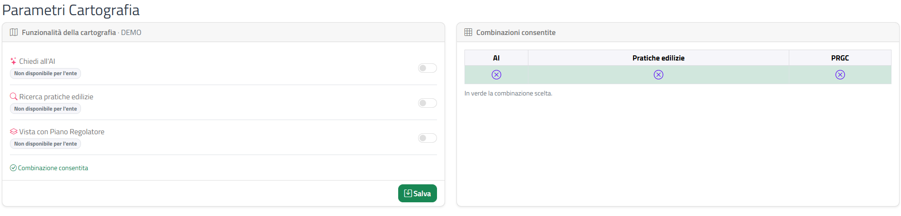

# Parametri cartografia

Questa sezione spiega come scegliere quali funzionalità della **cartografia** sono attive per il tuo comune (o per ciascun comune dell'Unione).

## Accedere alla pagina

Dal menu in alto scegli **Impostazioni › Parametri Cartografia**. Si apre la pagina **Parametri Cartografia**.

{: .note }
> La voce **Parametri Cartografia** compare nel menu solo se per il tuo Ente è configurata la cartografia. Se non la vedi, la funzione non è attiva per il tuo Ente.

## Scegliere il comune (solo Unioni di comuni)

Se il tuo Ente è un'Unione di comuni, in alto compare il riquadro **Comune dell'unione**:

1. Apri il menu **Comune** (puoi scrivere per cercare).
2. Seleziona il comune di cui impostare la cartografia.

La pagina si aggiorna e mostra le impostazioni del comune scelto. Per un Ente con un solo comune questo riquadro non c'è e le impostazioni compaiono subito.

Se il comune non risulta configurato per la cartografia compare la finestra **Attenzione** con il messaggio "Il comune non risulta configurato per la cartografia."

## Funzionalità della cartografia

Il riquadro **Funzionalità della cartografia** riporta nell'intestazione il nome del comune e contiene tre interruttori:

| Funzionalità | Descrizione |
|--------------|-------------|
| **Chiedi all'AI** | Funzione di assistente basato su intelligenza artificiale nella cartografia |
| **Ricerca pratiche edilizie** | Ricerca delle pratiche edilizie dalla cartografia |
| **Vista con Piano Regolatore** | Visualizzazione della cartografia con il Piano Regolatore (PRGC) |

Se una funzionalità non è disponibile per il tuo Ente, sotto il suo nome compare l'etichetta **Non disponibile per l'ente** e l'interruttore è bloccato: al salvataggio quella funzionalità mantiene il valore già impostato.

## Combinazioni consentite

Non tutte le combinazioni dei tre interruttori sono ammesse. Il riquadro **Combinazioni consentite** elenca quelle permesse, una per riga, con le colonne **AI**, **Pratiche edilizie** e **PRGC** (spunta verde = attiva, cerchio con la X = non attiva).

Mentre sposti gli interruttori:

- la riga corrispondente alla tua scelta si colora di verde ("In verde la combinazione scelta.");
- sotto gli interruttori compare **Combinazione consentita** in verde, oppure **Combinazione non consentita: scegli una di quelle in tabella** in rosso;
- con una combinazione non consentita il pulsante **Salva** è disattivato.

## Salvare le impostazioni

1. Imposta gli interruttori su una combinazione consentita.
2. Clicca su **Salva**.

Compare la notifica verde **Impostazioni salvate** con il nome del comune. Se la combinazione non è ammessa il salvataggio viene rifiutato con il messaggio "Combinazione non consentita: scegli una delle combinazioni indicate nella tabella."; per un'Unione senza comune scelto compare "Selezionare un comune."

{: .warning }
> Le impostazioni cambiano le funzionalità della cartografia disponibili per il comune scelto.

## Pagine collegate

- [Scheda Ente](scheda-ente.html): i dati generali dell'Ente.
- [Interfaccia e convenzioni](interfaccia-e-convenzioni.html): notifiche e finestra Attenzione.
