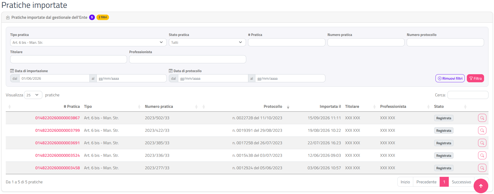

# Pratiche importate

Questa sezione spiega come consultare l'elenco delle **pratiche importate**, cioè le pratiche presentate all'Ente prima di GeoTecSUE (o su altri canali) e registrate nel gestionale dell'Ente, che un professionista ha collegato al proprio profilo GeoTecSUE per poterci inviare comunicazioni, integrazioni e pagamenti.

Dal lato del professionista l'importazione è descritta nel manuale dei professionisti, alla pagina "Importazione pratiche pregresse". Se l'Ente ha scelto di confermare ogni importazione, le richieste arrivano prima nella pagina [Richieste di importazione](richieste-importazione.html) e compaiono qui solo dopo che le hai consentite.

{: .note }
> Le pratiche importate non compaiono in questo elenco finché non sono state effettivamente importate. Una richiesta ancora in attesa o rifiutata non è una pratica importata.

## Accedere alla pagina

Dal menu in alto scegli **Gestione Pratiche › Pratiche Importate**.

La voce di menu compare solo se per il tuo Ente è attiva l'importazione delle pratiche dal gestionale (nella [Scheda Ente](scheda-ente.html), campo **Collegamento pratiche Sequoia su SUE** impostato su **Attivo** oppure **Attivo con conferma dell'Ente**). Se non la vedi, la funzione non è attiva.

La pagina si intitola **Pratiche importate** e contiene un'unica scheda, **Pratiche importate dal gestionale dell'Ente**. Accanto al titolo della scheda trovi:

- un badge viola con il **numero di pratiche** trovate con i filtri correnti;
- un badge giallo con il numero di **filtri attivi** (es. "2 filtri"), visibile solo quando almeno un filtro è impostato.

## Filtrare l'elenco

Nella parte alta della scheda c'è il riquadro dei filtri. Quando apri la pagina dal menu i filtri sono vuoti e l'elenco mostra tutte le pratiche importate del tuo Ente.

| Filtro | Cosa cerca |
|---|---|
| **Tipo pratica** | Il tipo di pratica come risulta dal gestionale. L'elenco propone solo i tipi presenti tra le pratiche importate del tuo Ente. **Tutti** non filtra. |
| **Stato pratica** | Lo stato della pratica in GeoTecSUE (Inviata, Protocollata, Registrata, Esecutiva e così via). **Tutti** non filtra. |
| **# Pratica** | Il numero (chiave) della pratica in GeoTecSUE. |
| **Numero pratica** | Il numero della pratica nel gestionale dell'Ente. |
| **Numero protocollo** | Il numero di protocollo della pratica. |
| **Titolare** | Il nominativo del titolare. |
| **Professionista** | Il nominativo del professionista che ha importato la pratica. |
| **Data di importazione** (**dal** / **al**) | Il giorno in cui la pratica è stata importata in GeoTecSUE. |
| **Data di protocollo** (**dal** / **al**) | La data di protocollo della pratica. |

Per applicare i filtri:

1. Compila uno o più campi. Per le date clicca nel campo e scegli il giorno dal calendario, oppure scrivilo nel formato gg/mm/aaaa.
2. Clicca su **Filtra** (o premi Invio in uno dei campi).

L'elenco si aggiorna e il badge giallo mostra quanti filtri sono attivi. Per tornare all'elenco completo clicca su **Rimuovi filtri**: il pulsante compare solo quando c'è almeno un filtro attivo.

Se una data non è valida o se in un intervallo la data iniziale è successiva a quella finale, si apre la finestra **Attenzione** con il motivo (ad esempio "Nell'intervallo della data di importazione la data iniziale è successiva a quella finale.") e l'elenco non viene aggiornato.

{: .note }
> I filtri vengono ricordati quando apri il dettaglio di una pratica e torni indietro con **Ritorna**. Se invece riapri la pagina dal menu, i filtri ripartono vuoti.

## L'elenco delle pratiche

Sotto i filtri c'è la tabella delle pratiche importate, ordinata all'inizio per **Importata il** dalla più recente. Ricerca rapida, ordinamento per colonna e paginazione (25 righe per pagina) funzionano come descritto in [Interfaccia e convenzioni](interfaccia-e-convenzioni.html).

| Colonna | Contenuto |
|---|---|
| **# Pratica** | Il numero della pratica in GeoTecSUE. È un collegamento: cliccalo per aprire il dettaglio. |
| **Comune** | Il Comune della pratica. Compare solo se l'Ente è un multiente (ad esempio un'Unione di Comuni). |
| **Tipo** | Il tipo di pratica. |
| **Numero pratica** | Il numero della pratica nel gestionale dell'Ente. |
| **Protocollo** | Numero e data di protocollo, nella forma "n. 1234 del 15/03/2022". |
| **Importata il** | Data e ora dell'importazione in GeoTecSUE. |
| **Titolare** | Il titolare, in maiuscolo. |
| **Professionista** | Il professionista che gestisce la pratica in GeoTecSUE, in maiuscolo. |
| **Stato** | Lo stato attuale, con un badge colorato (vedi [Stati delle pratiche](appendici/stati-pratica.html)). |
| *(ultima colonna)* | Il pulsante con la lente, che apre il dettaglio. |

Se nessuna pratica corrisponde ai filtri la tabella mostra "Nessuna pratica importata corrisponde ai filtri.".

## Aprire il dettaglio di una pratica

1. Individua la pratica nell'elenco.
2. Clicca sul numero nella colonna **# Pratica** oppure sul pulsante con la lente in fondo alla riga.

Si apre la pagina [Dettaglio della pratica importata](dettaglio-importata.html). Da lì, con **Ritorna**, torni a questo elenco con i filtri, la pagina e l'ordinamento che avevi lasciato.

{: .note }
> Le pratiche importate hanno un dettaglio dedicato, diverso da quello delle pratiche presentate direttamente su GeoTecSUE: anche se apri una pratica importata da un altro elenco, ad esempio da [Pratiche e comunicazioni trasmesse](pratiche-trasmesse.html), il sistema ti porta sempre al dettaglio della pratica importata.

## Pagine collegate

- [Dettaglio della pratica importata](dettaglio-importata.html)
- [Richieste di importazione](richieste-importazione.html)
- [Pratiche e comunicazioni trasmesse](pratiche-trasmesse.html), dove trovi anche le comunicazioni che i professionisti inviano sulle pratiche importate
