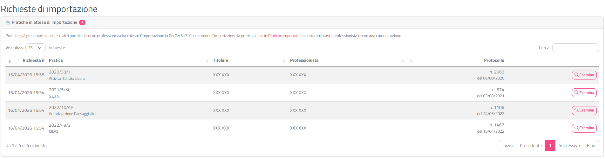
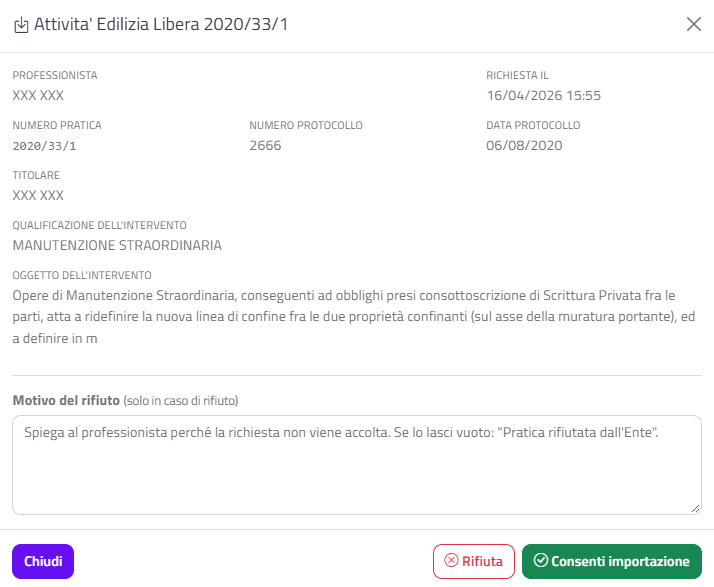

# Richieste di importazione

Questa sezione spiega come gestire le **richieste di importazione**: le domande con cui un professionista chiede di collegare a GeoTecSUE una pratica pregressa, già presente nel gestionale dell'Ente, per poterci inviare comunicazioni, integrazioni e pagamenti. Tu decidi se **consentire** l'importazione o **rifiutarla** indicando il motivo.

## Il flusso completo

### Come si attiva

L'importazione delle pratiche pregresse si configura nella [Scheda Ente](scheda-ente.html), campo **Collegamento pratiche Sequoia su SUE**:

| Valore | Effetto |
|---|---|
| **Disattivo** | I professionisti non possono importare pratiche pregresse. |
| **Attivo** | Il professionista importa la pratica in autonomia: l'importazione è immediata e la pratica compare subito in [Pratiche importate](pratiche-importate.html). |
| **Attivo con conferma dell'Ente** | Il professionista invia una richiesta, che resta in attesa finché l'Ente non la esamina da questa pagina. |

Questa pagina, e la relativa voce di menu, serve solo con il valore **Attivo con conferma dell'Ente**.

La tendina si può cambiare solo se per l'Ente è configurato il collegamento web con Sequoia (la stessa condizione dell'interruttore **Attiva consultazione Online**); altrimenti è grigia e mostra il valore salvato.

{: .note }
> Se la tendina è grigia, rivolgiti all'assistenza SISCOM. Per un Ente che utilizza già Sequoia sul sistema **Nuvola** il collegamento web deve essere presente e la tendina deve essere modificabile: se non lo è, si tratta di una configurazione che SISCOM deve completare, non di una funzione esclusa per il tuo Ente.

### I passaggi

1. **Il professionista chiede l'importazione.** Dal proprio portale, nel menu **Le mie istanze › Gestione Istanze non presenti su GeoTecSUE**, il professionista vede le pratiche del gestionale dell'Ente in cui risulta come professionista principale (la ricerca avviene sul suo codice fiscale), sceglie quella che gli interessa e clicca su **Importa**. Con la conferma dell'Ente attiva, l'operazione diventa una richiesta in attesa.
2. **La richiesta arriva all'Ente.** Compare nell'elenco di questa pagina, con la data e l'ora della richiesta.
3. **L'Ente esamina la richiesta** e verifica che la pratica sia davvero di competenza del portale e del professionista (ad esempio che non si tratti di una pratica SUAP o di una pratica di un altro tecnico).
4. **L'Ente decide:**
   - **consente** l'importazione: la pratica viene creata in GeoTecSUE e collegata al professionista;
   - **rifiuta** la richiesta, indicando il motivo.
5. **Il professionista riceve una comunicazione** con l'esito (vedi [Cosa riceve il professionista](#cosa-riceve-il-professionista)).
6. **Se l'importazione è consentita**, la richiesta sparisce da questo elenco e la pratica compare in [Pratiche importate](pratiche-importate.html). Da lì puoi aprirne il [dettaglio](dettaglio-importata.html). Il professionista la trova tra le sue pratiche importate e può iniziare a inviare comunicazioni e integrazioni.

Se la richiesta viene rifiutata, sparisce comunque dall'elenco e la pratica non viene importata.

{: .note }
> Non vengono importati gli allegati originali della pratica: restano nel gestionale dell'Ente. In GeoTecSUE arrivano i dati della pratica (numero, protocollo, tipo, titolare, qualificazione e oggetto dell'intervento) e da quel momento tutto ciò che il professionista invia.

## Accedere alla pagina

Dal menu in alto scegli **Gestione Pratiche › Gestione Richieste Importazione**.

La voce compare solo se nella [Scheda Ente](scheda-ente.html) il campo **Collegamento pratiche Sequoia su SUE** è impostato su **Attivo con conferma dell'Ente**.

La pagina si intitola **Richieste di importazione** e contiene la scheda **Pratiche in attesa di importazione**. Accanto al titolo un badge indica quante richieste sono in attesa: è rosa se ce n'è almeno una, grigio se non ce ne sono. Sotto il titolo una riga ricorda in breve come funziona l'importazione.

## L'elenco delle richieste

L'elenco mostra solo le richieste **in attesa**: quelle già consentite o rifiutate non compaiono più. È ordinato all'inizio per **Richiesta il**, dalla più recente. Ricerca rapida, ordinamento e paginazione funzionano come descritto in [Interfaccia e convenzioni](interfaccia-e-convenzioni.html).

| Colonna | Contenuto |
|---|---|
| **Richiesta il** | Data e ora in cui il professionista ha chiesto l'importazione. |
| **Pratica** | Il numero della pratica nel gestionale (anno/numero/sigla) e, sotto, il tipo di pratica. |
| **Titolare** | Il titolare della pratica. |
| **Professionista** | Il professionista che ha fatto la richiesta. |
| **Protocollo** | Numero e, sotto, data di protocollo della pratica. |
| *(ultima colonna)* | Il pulsante **Esamina**. |

Se non ci sono richieste la tabella mostra "Nessuna richiesta di importazione in attesa.".

## Esaminare una richiesta

Clicca su **Esamina** nella riga della richiesta. Si apre una finestra intitolata con il tipo e il numero della pratica, che contiene:

| Campo | Contenuto |
|---|---|
| **Professionista** | Chi ha chiesto l'importazione. |
| **Richiesta il** | Data e ora della richiesta. |
| **Numero pratica** | Il numero nel gestionale. |
| **Numero protocollo** e **Data protocollo** | Il protocollo della pratica. |
| **Titolare** | Il titolare. |
| **Qualificazione dell'intervento** | La qualificazione. |
| **Oggetto dell'intervento** | La descrizione dell'intervento. |

Se la pratica era arrivata al gestionale da un altro portale telematico compare anche un riquadro con **Portale**, **Tipo pratica sul portale** e **Codice pratica sul portale**.

In fondo alla finestra c'è il campo **Motivo del rifiuto**, da compilare solo se rifiuti, e i pulsanti **Chiudi**, **Rifiuta** e **Consenti importazione**.

## Consentire l'importazione

1. Nella finestra della richiesta clicca su **Consenti importazione**.
2. Si apre la finestra **Consentire l'importazione?**, che ricorda: "La pratica … verrà importata in GeoTecSUE e comparirà in Pratiche importate."
3. Clicca su **Consenti importazione** per confermare, oppure su **Annulla** per tornare alla richiesta.

Al termine la pagina si ricarica, la richiesta sparisce dall'elenco e compare la notifica verde "Importazione consentita (pratica …)" con il dettaglio "Il professionista è stato avvisato. La pratica è ora in Pratiche importate.".

Nello **Storico** della pratica importata viene registrata l'operazione "Pratica importata da gestionale con consenso dell'Ente".

{: .warning }
> L'operazione non si può annullare e il professionista riceve subito una comunicazione.

## Rifiutare la richiesta

1. Nella finestra della richiesta scrivi nel campo **Motivo del rifiuto** perché la richiesta non viene accolta (al massimo 2000 caratteri). Il testo arriva al professionista: scrivilo in modo chiaro.
2. Clicca su **Rifiuta**.
3. Si apre la finestra **Rifiutare la richiesta?**. Se hai lasciato vuoto il motivo, la finestra avvisa che verrà usato il motivo predefinito "Pratica rifiutata dall'Ente".
4. Clicca su **Rifiuta** per confermare, oppure su **Annulla**: torni alla richiesta e il motivo che avevi scritto resta nel campo.

Al termine la pagina si ricarica, la richiesta sparisce dall'elenco e compare la notifica verde "Richiesta rifiutata (pratica …)" con il dettaglio "Il professionista è stato avvisato con il motivo del rifiuto.".

{: .warning }
> Il rifiuto non si può annullare e il motivo viene inviato al professionista così come l'hai scritto.

## Cosa riceve il professionista

L'esito arriva al professionista secondo il canale scelto nella [Scheda Ente](scheda-ente.html), campo **Tipo notifica** (**Mail normale**, **PEC** o **Entrambe**; per la PEC vedi [Configurazioni PEC](configurazioni-pec.html)).

| Esito | Avviso nel portale del professionista | Mail / PEC |
|---|---|---|
| Importazione consentita | ✅ "Pratica importata da gestionale", con numero della pratica e titolare | ✅ oggetto "GeotecSUE: Consenso Importazione" |
| Richiesta rifiutata | ❌ | ✅ oggetto "GeotecSUE: Rifiuto Importazione", con numero, tipologia, primo titolare e motivazione |

Se l'operazione è andata a buon fine ma la comunicazione non è partita, la notifica verde lo segnala ("Attenzione: la comunicazione al professionista non è stata inviata."). L'importazione o il rifiuto restano comunque registrati: in questo caso avvisa tu il professionista.

## Messaggi di errore

| Messaggio | Cosa significa |
|---|---|
| "La richiesta non è più in attesa (potrebbe essere già stata gestita): ricarica la pagina." | Qualcun altro ha già gestito la richiesta, oppure non è più in attesa. Ricarica la pagina. |
| "Non è stato possibile importare la pratica. …" | L'importazione dal gestionale non è riuscita. La finestra della richiesta si riapre con il messaggio in rosso: riprova tra qualche minuto. |
| "Non è stato possibile registrare il rifiuto. …" | Il rifiuto non è stato salvato. La finestra si riapre con il motivo già scritto. |
| "Il motivo del rifiuto può contenere al massimo 2000 caratteri." | Accorcia il testo e riprova. |
