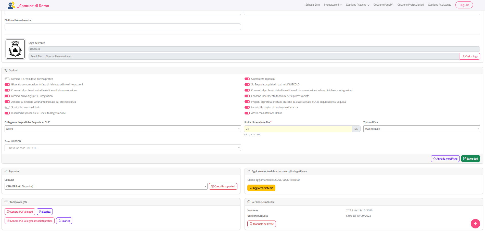
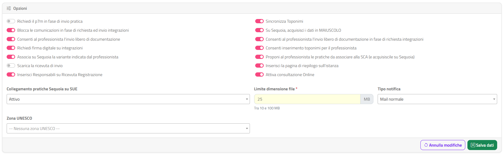

# Scheda Ente

Questa sezione spiega come usare la **Scheda Ente**, la pagina iniziale del back office: qui controlli e modifichi i dati del tuo Ente, il logo e le opzioni che regolano il comportamento del portale dei professionisti, e trovi alcuni strumenti di servizio.

## Accedere alla pagina

La Scheda Ente si apre automaticamente dopo l'[accesso](accesso.html). Per tornarci in qualsiasi momento:

- clicca su **Scheda Ente** nel menu, oppure
- clicca sul logo e sul nome dell'Ente in alto a sinistra.

La pagina ha il titolo **Impostazioni ente** ed è divisa in card:

| Card | Contenuto |
|------|-----------|
| **Dati dell'ente** | Anagrafica, recapiti, privacy, logo (e consenso PNRR per la Lombardia) |
| **Opzioni** | Interruttori e impostazioni del portale, pulsanti **Annulla modifiche** e **Salva dati** |
| **Toponimi** | Cancellazione dei toponimi di un comune |
| **Aggiornamento del sistema con gli allegati base** | Data dell'ultimo aggiornamento e pulsante **Aggiorna sistema** |
| **Stampa allegati** | Generazione e scaricamento dei PDF con la lista degli allegati |
| **Versione e manuale** | Versione del sistema e manuale dell'Ente |

{: .warning }
> Le modifiche alle card **Dati dell'ente** e **Opzioni** si salvano insieme con il pulsante **Salva dati**, che si trova in fondo alla card **Opzioni**. Se cambi un dato e apri un'altra pagina senza salvare, la modifica va persa. Il logo, invece, si salva subito con **Carica logo**.

## Dati dell'ente

I campi con l'asterisco rosso **\*** sono obbligatori.

| Campo | Descrizione |
|-------|-------------|
| **Ragione sociale** \* | Nome dell'Ente, mostrato in alto nel back office e nei documenti. |
| **Codice ente** | Codice dell'Ente nel portale (usato nel collegamento di accesso). Non modificabile. |
| **Username** | Nome utente con cui si accede al back office. Non modificabile. |
| **E-mail** \* | Indirizzo e-mail dell'Ente. |
| **Mail per comunicazioni** \* | Indirizzo e-mail usato per le comunicazioni del portale. |
| **PEC** \* | Indirizzo PEC dell'Ente. |
| **Indirizzo** \*, **Città** \*, **Provincia** \* | Sede dell'Ente. |
| **Telefono** \* | Numero di telefono dell'Ente. |
| **Indirizzo informativa privacy** | Indirizzo web dell'informativa sul trattamento dei dati personali. |
| **Responsabile del trattamento dei dati** | Nome del responsabile del trattamento. |
| **Mail del responsabile del trattamento** | E-mail del responsabile del trattamento. |
| **Dicitura firma ricevuta** | Testo che compare come firma nella ricevuta di registrazione rilasciata al professionista. |

### Sito pubblico

Accanto alla **Ragione sociale** trovi il pulsante **Sito pubblico**: apre in una nuova scheda del browser la pagina iniziale del portale GeoTecSUE del tuo Ente, così come la vedono i professionisti. Usalo per controllare l'effetto delle modifiche (news, logo, dati dell'Ente).

### Logo dell'ente

A sinistra vedi l'anteprima del logo attuale; il campo sopra il pulsante di scelta indica il nome del file (o *"Nessun logo caricato"*).

Per cambiare il logo:

1. Clicca nel campo di scelta del file e seleziona l'immagine dal computer. Sono accettati i formati **JPG/JPEG**, **PNG**, **GIF** e **BMP**.
2. Clicca su **Carica logo**.

Il nuovo logo sostituisce il precedente, compare subito nell'anteprima e ricevi la notifica *"Logo aggiornato"*. Non serve cliccare **Salva dati**.

| Messaggio | Causa |
|-----------|-------|
| *ATTENZIONE: Nessun file caricato.* | Hai cliccato **Carica logo** senza scegliere un file. |
| *ATTENZIONE: Estensione del file non valida.* | Il file non è un'immagine nei formati ammessi. |
| *Non è stato possibile caricare il logo.* | Il caricamento non è riuscito: riprova. |

### Consenso PNRR (solo Regione Lombardia)

Per gli Enti della Regione Lombardia, in fondo alla card compare un riquadro giallo con l'interruttore **Acconsenti al trattamento dei dati per il PNRR** e il collegamento **vedi lettera**, che apre il testo della lettera della Regione sulla raccolta dei dati dei procedimenti edilizi per il PNRR.

Per dare il consenso:

1. Leggi la lettera con **vedi lettera**.
2. Attiva l'interruttore **Acconsenti al trattamento dei dati per il PNRR**.
3. Clicca su **Salva dati**.

Il riquadro diventa verde e riporta *"PNRR – Autorizzazione all'accesso ai dati relativi ai procedimenti amministrativi in materia di edilizia ed urbanistica concessa:"* con data e ora del consenso.

{: .note }
> Una volta concesso, il consenso non si può revocare da questa pagina: il riquadro mostra solo la data dell'autorizzazione.

## Opzioni

La card **Opzioni** contiene gli interruttori che regolano il comportamento del portale per i professionisti e per il collegamento con il gestionale Sequoia. Un interruttore spostato a destra (colorato) indica che l'opzione è attiva.

### Interruttori

| Opzione | Effetto quando è attiva |
|---------|-------------------------|
| **Richiedi il p7m in fase di invio pratica** | Al momento dell'invio della pratica il professionista deve caricare l'istanza firmata digitalmente (file .p7m). |
| **Sincronizza Toponimi** | Mantiene allineato l'elenco dei toponimi (vie e piazze) del portale con quello del gestionale. |
| **Blocca le comunicazioni in fase di richiesta ed invio integrazioni** | Mentre una pratica è in richiesta di integrazioni, il professionista non può inviare altre comunicazioni su quella pratica. |
| **Su Sequoia, acquisisci i dati in MAIUSCOLO** | I dati delle pratiche vengono acquisiti nel gestionale Sequoia in lettere maiuscole. |
| **Consenti al professionista l'invio libero di documentazione** | Il professionista può inviare documentazione volontaria sulle proprie pratiche. |
| **Consenti al professionista l'invio libero di documentazione in fase di richiesta integrazioni** | In fase di richiesta integrazioni, consente l'invio anche di ulteriore documentazione non contemplata dalla richiesta di integrazioni. |
| **Richiedi firma digitale su integrazioni** | Le integrazioni inviate dal professionista devono essere firmate digitalmente. |
| **Consenti inserimento toponimi per il professionista** | Il professionista può scrivere un toponimo che non è presente nell'elenco. |
| **Associa su Sequoia la variante indicata dal professionista** | Quando il professionista indica che la pratica è una variante, il collegamento alla pratica originale viene riportato anche in Sequoia. |
| **Proponi al professionista le pratiche da associare alla SCA (e acquisiscile su Sequoia)** | Nella Segnalazione Certificata di Agibilità il professionista può scegliere le pratiche a cui si riferisce; il collegamento viene acquisito in Sequoia. |
| **Scarica la ricevuta di invio** | Tra i documenti che vengono allegati alla pratica in fase di scarico su Sequoia, viene inserita anche la ricevuta di invio della pratica stessa. |
| **Inserisci la pagina di riepilogo sull'istanza** | Aggiunge una pagina di riepilogo al PDF dell'istanza. Non compare per gli Enti della Regione Lombardia (viene utilizzato il *Modulo Unico Titolare*). |
| **Inserisci Responsabili su Ricevuta Registrazione** | Riporta i responsabili (es. del procedimento) sulla ricevuta di registrazione inviata al professionista. |
| **Attiva consultazione Online** | Attiva la nuova gestione della consultazione, con tutte le pratiche lette dal gestionale Sequoia: la consultazione all'interno di GeoTecSUE e la possibilità di creare la **Consultazione web**, una pagina pubblica con un link da pubblicare ovunque, ad esempio sul sito dell'Ente (vedi [Consultazione](consultazione.html)). È modificabile solo se per l'Ente è configurato il collegamento web con Sequoia; altrimenti è spenta e grigia. |

### Altre impostazioni

| Campo | Valori | Descrizione |
|-------|--------|-------------|
| **Collegamento pratiche Sequoia su SUE** | **Disattivo**, **Attivo**, **Attivo con conferma dell'Ente** | Regola la possibilità di collegare al portale le pratiche già presenti nel gestionale Sequoia (pratiche importate). Con **Attivo con conferma dell'Ente** le richieste dei professionisti devono essere confermate dall'Ente nella pagina [Richieste di importazione](richieste-importazione.html), e nel menu compare la voce **Gestione Richieste Importazione**. Come **Attiva consultazione Online**, la tendina è modificabile solo se per l'Ente è configurato il collegamento web con Sequoia; altrimenti è grigia e mostra il valore salvato. In questo caso rivolgiti all'assistenza SISCOM: se l'Ente utilizza già Sequoia sul sistema **Nuvola**, il collegamento web deve essere presente e la tendina modificabile, quindi la sua mancanza è una configurazione che SISCOM deve completare. |
| **Limite dimensione file** \* | Da 10 a 100 (MB) | Dimensione massima di ogni file che il professionista può caricare. Se il valore non è mai stato impostato viene proposto 25. |
| **Tipo notifica** | **Mail normale**, **PEC**, **Entrambe** | Canale con cui il portale invia le notifiche. Per scegliere **PEC** o **Entrambe** devi prima configurare la casella in [Configurazioni PEC](configurazioni-pec.html). |
| **Zona UNESCO** | Elenco delle zone | Zona UNESCO dell'Ente. Puoi svuotare la scelta con la **X**. |

Per le pratiche importate vedi anche [Pratiche importate](pratiche-importate.html).

## Salvare o annullare le modifiche

In fondo alla card **Opzioni**:

- **Salva dati** (verde): salva tutti i dati e le opzioni delle card **Dati dell'ente** e **Opzioni**. Se è tutto corretto ricevi la notifica *"Impostazioni salvate"*.
- **Annulla modifiche**: ricarica i dati salvati, annullando le modifiche non ancora salvate.

### Controlli al salvataggio

| Messaggio | Causa | Cosa fare |
|-----------|-------|-----------|
| *Attenzione dati mancanti !!!* | Uno dei campi obbligatori (Ragione sociale, E-mail, Mail per comunicazioni, PEC, Indirizzo, Città, Provincia, Telefono) è vuoto. | Compila il campo e salva di nuovo. |
| *La dimensione del file deve essere compresa tra 10 e 100 MB* | Il **Limite dimensione file** è fuori dall'intervallo. | Inserisci un valore tra 10 e 100. |
| *Necessario configurare i parametri della PEC* | Hai scelto **PEC** o **Entrambe** in **Tipo notifica** ma la PEC non è configurata. La tendina torna su **Mail normale**. | Configura la PEC in [Configurazioni PEC](configurazioni-pec.html), poi torna qui e cambia il **Tipo notifica**. |

In caso di errore nessuna modifica viene salvata: correggi e clicca di nuovo **Salva dati**.

{: .note }
> Dopo aver cambiato **Collegamento pratiche Sequoia su SUE**, riapri la Scheda Ente dal menu per aggiornare le voci del menu **Gestione Pratiche**.

## Toponimi

La card **Toponimi** mostra nella tendina **Comune** i comuni del tuo Ente (tutti i comuni, se l'Ente ne gestisce più di uno), ciascuno con il numero di toponimi presenti, ad esempio *COMUNE (61 Toponimi)*.

Per cancellare i toponimi di un comune:

1. Seleziona il comune nella tendina **Comune**.
2. Clicca su **Cancella toponimi**.

Ricevi la notifica *"Toponimi di … cancellati"* e il conteggio nella tendina si aggiorna.

{: .warning }
> **Cancella toponimi** elimina subito tutti i toponimi del comune selezionato, **senza chiedere conferma**, e l'operazione non si può annullare. I professionisti non troveranno più le vie di quel comune finché i toponimi non vengono caricati di nuovo. Il caricamento dei toponimi deve essere rifatto a mezzo Sequoia.

## Aggiornamento del sistema con gli allegati base

La card indica la data dell'**Ultimo aggiornamento**, oppure *In aggiornamento* se un aggiornamento è in corso.

Il pulsante **Aggiorna sistema** riporta la configurazione degli **allegati** e della **modulistica** del tuo Ente a quella del sistema base, predisposta centralmente.

{: .warning }
> **L'aggiornamento cancella tutte le modifiche fatte manualmente dall'Ente sugli allegati e sulla modulistica.**
>
> La configurazione viene sostituita con quella base: tutto ciò che l'Ente ha aggiunto o cambiato a mano nelle pagine [Allegati](allegati.html), [Allegati in pratica](allegati-in-pratica.html) e [Modulistica](modulistica.html) **va perso e non si può recuperare**. Ad esempio:
>
> - l'**obbligatorietà** di un allegato modificata rispetto a quella base (un allegato reso obbligatorio o facoltativo);
> - le **nuove associazioni** di un allegato a un tipo di pratica;
> - i **nuovi allegati** creati dall'Ente;
> - i **nuovi moduli** caricati nella modulistica.
>
> Dopo l'aggiornamento queste modifiche vanno **rifatte a mano**.

### Prima di aggiornare

1. Avvia l'aggiornamento solo se serve davvero, ad esempio su indicazione dell'assistenza.
2. Annota le modifiche fatte dal tuo Ente su allegati e modulistica. Per gli allegati puoi generare e scaricare i PDF della card [Stampa allegati](#stampa-allegati): fotografano la configurazione attuale e ti servono come promemoria per rifare le modifiche.
3. Scegli un momento di scarso utilizzo del portale: durante e subito dopo l'aggiornamento i professionisti trovano la configurazione base.

### Avviare l'aggiornamento

1. Clicca su **Aggiorna sistema**.
2. Nella finestra **Aggiornamento del sistema** leggi la domanda *"Procedere con l'aggiornamento del sistema con gli allegati base?"*.
3. Clicca su **Aggiorna** per confermare (oppure **Annulla** per rinunciare).

Ricevi la notifica *"Aggiornamento avviato"* e la card mostra *In aggiornamento*. L'aggiornamento prosegue in background: al termine, ricaricando la pagina, vedrai la nuova data di ultimo aggiornamento.

Se un aggiornamento è già in corso compare il messaggio *"Sistema attualmente in aggiornamento: attendere il completamento"*.

### Dopo l'aggiornamento

Quando la card mostra la nuova data di **Ultimo aggiornamento**, controlla le pagine [Allegati](allegati.html), [Allegati in pratica](allegati-in-pratica.html) e [Modulistica](modulistica.html) e rifai le modifiche annotate.

## Stampa allegati

La card **Stampa allegati** permette di ottenere due PDF riepilogativi della configurazione degli allegati del tuo Ente.

| Pulsante | Contenuto del PDF | Nome del file scaricato |
|----------|-------------------|-------------------------|
| **Genera PDF allegati** | *Lista allegati per tipologia di pratica*: per ogni tipo di pratica attivo, gli allegati previsti con le colonne **Allegato**, **Categoria**, **Formato**, **Obbligatorio**, **Firma digitale**, **Condizione di obbligatorietà**. | PDF Allegati.pdf |
| **Genera PDF allegati associati pratica** | *Lista allegati associati alle tipologie di pratica*: l'elenco degli allegati dell'Ente con le colonne **Allegato**, **Categoria**, **Tipologie di pratica associate**. | PDF Allegati 2.pdf |

Entrambi i PDF riportano in testa il nome dell'Ente e la data (*"Situazione al gg/mm/aaaa"*).

Per ottenere un PDF aggiornato:

1. Clicca su **Genera PDF allegati** (oppure **Genera PDF allegati associati pratica**).
2. Attendi: compare lo spinner e la generazione può durare qualche decina di secondi.
3. Al termine ricevi la notifica *"PDF allegati generato"* (o *"PDF allegati associati pratica generato"*) con l'indicazione *"Usa Scarica per aprirlo."*.
4. Clicca su **Scarica** accanto al pulsante usato: il PDF viene scaricato.

Il pulsante **Scarica** compare solo quando il PDF è disponibile. Se un PDF era già stato generato in precedenza, puoi scaricarlo subito senza rigenerarlo; ricorda però che rispecchia la situazione alla data della sua generazione.

{: .note }
> Generare di nuovo un PDF cancella prima quello precedente. Se la generazione non riesce, il pulsante **Scarica** non compare finché non generi il PDF con successo.

| Messaggio | Cosa fare |
|-----------|-----------|
| *Non è stato possibile generare il PDF. Riprova tra qualche minuto.* | Riprova più tardi. |
| *La generazione del PDF sta richiedendo troppo tempo. Ricarica la pagina tra qualche minuto per verificare se è disponibile.* | Ricarica la pagina dopo qualche minuto: se il PDF è pronto compare **Scarica**. |
| *Il PDF non risulta ancora disponibile. Ricarica la pagina tra qualche minuto oppure generalo di nuovo.* | Come sopra. |
| *File non disponibile* | Il PDF non è più presente: generalo di nuovo. |

Gli allegati e la loro associazione ai tipi di pratica si configurano in [Allegati](allegati.html) e [Allegati in pratica](allegati-in-pratica.html).

## Versione e manuale

La card **Versione e manuale** riporta:

- **Versione**: versione del sistema GeoTecSUE e data di rilascio;
- **Versione Sequoia**: versione del collegamento con il gestionale Sequoia e data.

Il pulsante **Manuale dell'ente** ti porta alla prima pagina di questo manuale.

## Errori

Gli errori della pagina compaiono nella finestra **Attenzione** descritta in [Interfaccia e convenzioni](interfaccia-e-convenzioni.html#finestra-di-errore). Il messaggio *"Impossibile leggere i dati dell'ente"* indica che i dati non sono stati caricati: ricarica la pagina e, se il problema resta, contatta l'assistenza.
